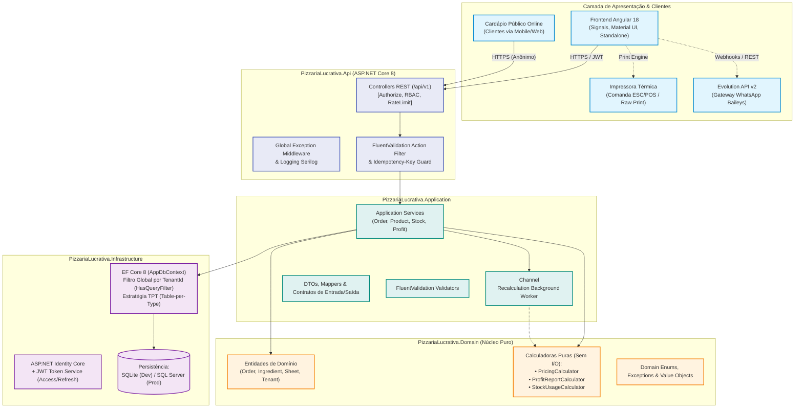
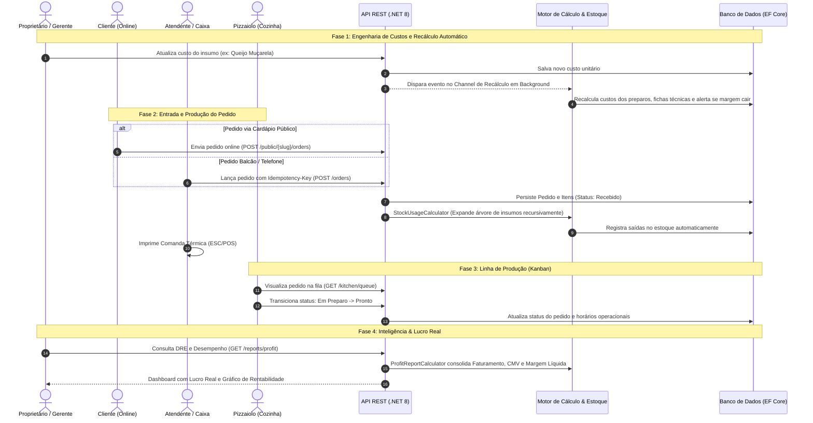

# 🍕 Pizzaria Lucrativa — SaaS Multi-Tenant de Precificação e Gestão Operacional Blueprint

[](https://dotnet.microsoft.com/)
[](https://angular.dev/)
[](https://learn.microsoft.com/ef/core/)
[](https://www.docker.com/)
[](backend/tests/)
[](docs/04-arquitetura.md)
[](docs/11-integracao-evolution-api-whatsapp.md)

> Sistema web **SaaS Multi-Tenant** de alta precisão projetado para resolver a dor crítica de precificação, gestão de custos de ingredientes/fichas técnicas, controle de estoque com baixa automática multinível, atendimento balcão/delivery com comanda térmica, fila Kanban de produção para pizzaiolos, cardápio digital público e apuração de **lucro real** — com total isolamento de dados por estabelecimento.

---

## 📌 Sumário

- [System Overview & Proposta de Valor](#-system-overview--proposta-de-valor)
- [Subdirectories & System Boundaries](#-subdirectories--system-boundaries)
- [Global Invariants](#-global-invariants)
- [Global Side Effects](#-global-side-effects)
- [System Verification](#-system-verification)
- [Arquitetura do Sistema](#-arquitetura-do-sistema)
- [Fluxo Operacional de Ponta a Ponta](#-fluxo-operacional-de-ponta-a-ponta)
- [Principais Funcionalidades](#-principais-funcionalidades)
- [Stack Tecnológica](#-stack-tecnológica)
- [Estrutura do Repositório](#-estrutura-do-repositório)
- [Como Executar o Projeto](#-como-executar-o-projeto)
  - [Opção 1: Via Docker (Recomendado)](#opção-1-via-docker-recomendado)
  - [Opção 2: Execução Local (Backend + Frontend)](#opção-2-execução-local-backend--frontend)
  - [Opção 3: Stack de WhatsApp (Evolution API)](#opção-3-stack-de-whatsapp-evolution-api)
- [Usuários de Demonstração (Seed Demo)](#-usuários-de-demonstração-seed-demo)
- [Suíte de Testes Automatizados](#-suíte-de-testes-automatizados)
- [Resumo da API REST](#-resumo-da-api-rest)
- [Documentação Técnica Completa](#-documentação-técnica-completa)

---

## 💡 System Overview & Proposta de Valor

A maioria das pizzarias sofre com **perda de margem invisível**: variação frequente nos insumos (farinha, laticínios, carnes), complexidade no cálculo de pizzas mistas (meio a meio / 4 sabores), ausência de rateio de custos fixos operacionais e falta de baixa automática no estoque.

O **Pizzaria Lucrativa** resolve esses gargalos integrando:
1. **Engenharia de Cardápio com Precisão Matemática**: Fórmulas com tolerância a frações de centavos, suporte a preparos intermediários (molhos, massas, recheios) e recálculo em cadeia em background.
2. **Operação Integrada de Pedidos**: Atendimento rápido balcão/delivery, impressão de comanda térmica para padrão 80mm/58mm e idempotência transacional.
3. **Fila Kanban da Cozinha**: Interface em tempo real para os pizzaiolos monitorarem itens pendentes, em preparo e finalizados.
4. **Cardápio Digital Público**: Link customizado (`/menu/{slug}`) para clientes consultarem sabores e realizarem pedidos online diretamente pelo smartphone.
5. **DRE e Lucro Real**: Consolidação diária, por produto e por canal (balcão, delivery, app), calculando o Custo de Mercadoria Vendida (CMV) real e a margem de contribuição líquida.

---

## 🗺️ Subdirectories & System Boundaries

- **backend**: [backend](./backend/README.md) - Solução .NET 8 em Clean Architecture contendo camadas de Domínio puro, Aplicação, Infraestrutura EF Core e API REST.
  - [PizzariaLucrativa.Domain](./backend/src/PizzariaLucrativa.Domain/README.md): Núcleo puro de regras de negócio, entidades multi-tenant e calculadoras sem I/O.
  - [PizzariaLucrativa.Application](./backend/src/PizzariaLucrativa.Application/README.md): Casos de uso, interfaces de serviço, DTOs, validadores FluentValidation e assistente Gemini.
  - [PizzariaLucrativa.Infrastructure](./backend/src/PizzariaLucrativa.Infrastructure/README.md): Persistência relacional (`AppDbContext`), Identity Core, filas assíncronas e cliente REST Gemini.
  - [PizzariaLucrativa.Api](./backend/src/PizzariaLucrativa.Api/README.md): Ponto de entrada HTTP, controllers REST v1, middlewares de exceção/tenant e Swagger.
- **frontend**: [frontend](./frontend/README.md) - SPA e PWA Angular 18 construído com Signals e Angular Material.
  - [frontend/src](./frontend/src/README.md): Código-fonte da aplicação web incluindo shell master, páginas públicas de cardápio e 18 módulos de funcionalidades operacionais.

---

## 🔒 Global Invariants

- **Multi-Tenant Data Isolation**: Todas as operações de banco de dados e consultas de serviço impõem isolamento rigoroso por `TenantId` via `ITenantProvider` e `HasQueryFilter` no EF Core. Nenhum tenant tem visibilidade ou capacidade de alterar registros de outro estabelecimento.
- **Pure Calculation Predictability**: Os motores de cálculo matemático e de estoque em `PizzariaLucrativa.Domain.Services` (`PricingCalculator`, `ProfitReportCalculator`, `StockUsageCalculator`, `UnitConverter`) são funções puras e determinísticas, sem dependência de I/O externo ou estados mutáveis.
- **Authentication & RBAC**: Todos os endpoints autenticados exigem JWT Bearer token emitido internamente com verificação de papéis (`Owner`, `Atendente`, `Pizzaiolo`, `Garcom`). Rotas com política `OwnerOnly` são restritas estritamente ao papel `Owner`.
- **Dimensional Compatibility**: Conversões de medidas (`UnitConverter`) rejeitam estritamente conversões entre grandezas físicas incompatíveis (massa vs. volume).
- **PT-BR Locale Standardization**: Todas as apresentações monetárias e decimais seguem a convenção brasileira (`pt-BR`, `R$`, vírgula decimal).

---

## ⚡ Global Side Effects

- **Database State Mutation**: Persiste transações e registros relacionais no SQLite (desenvolvimento) ou SQL Server (produção) via `AppDbContext`.
- **Asynchronous Recalculation Worker**: Alterações em insumos ou preparos postam identificadores na fila de background (`Channel<Guid>`), desencadeando recálculo assíncrono em cascata de fichas técnicas e combos.
- **Outbound AI Requests**: O módulo do assistente inteligente dispara requisições HTTPS externas para a API REST do Google Gemini (`generativelanguage.googleapis.com`) usando streaming e function-calling.
- **Third-Party Integrations**: Comunica-se com o gateway de WhatsApp (`Evolution API v2`) para automação de mensagens e com a API do ViaCEP para preenchimento automático de endereços no cardápio público.

---

## 🧪 System Verification

- Backend Tests:
  ```bash
  dotnet test backend/PizzariaLucrativa.slnx
  ```
- Frontend Tests:
  ```bash
  npm test --prefix frontend
  ```

---

## 📐 Arquitetura do Sistema

O projeto foi construído seguindo rigorosamente os princípios de **Clean Architecture**, **Domain-Driven Design (DDD)** e **SOLID**, garantindo desacoplamento e independência de infraestrutura.



---

## 🔄 Fluxo Operacional de Ponta a Ponta

O diagrama a seguir sintetiza o ciclo completo desde a alteração do custo de uma matéria-prima até a baixa de estoque e contabilização financeira do pedido:



---

## ✨ Principais Funcionalidades

| Módulo | Descrição |
|---|---|
| **Engenharia de Precificação** | Cálculo exato de custo de insumos, preparos e fichas técnicas por tamanho. Suporte a pizzas simples, meio a meio (fórmula ponderada/maior valor), 4 sabores, combos e bebidas com markup inteligente. |
| **Recálculo Assíncrono** | Alterações no preço de um ingrediente disparam automaticamente recálculo de todas as fichas e combos dependentes via fila de background (`System.Threading.Channels`), evitando travamentos. |
| **Multi-Tenancy Nativo** | Isolamento total por `TenantId` usando EF Core Global Query Filters. Nenhuma query acessa dados de outro restaurante. Identificação via claim do token JWT. |
| **Estoque Multinível Inteligente** | Baixa automática no momento da criação do pedido, percorrendo recursivamente fichas técnicas e preparos intermediários até o insumo base. |
| **PDV & Comanda Térmica** | Lançamento ágil de pedidos, cálculo automático de frete/taxas e layout de impressão otimizado para bobinas térmicas de 80mm e 58mm. |
| **KDS / Fila do Pizzaiolo** | Tela de cozinha limpa e objetiva para controle do tempo de preparo com transições de status (`Pendente` → `Em Preparo` → `Pronto` → `Finalizado`). |
| **Cardápio Digital Público** | Vitrine online sem necessidade de login, permitindo pedidos com tracking do status via código amigável. |
| **Lucro Real & DRE** | Apuração de receita bruta, descontos, taxas de cartão/plataforma, custos fixos proporcionais e CMV real para apurar o lucro líquido efetivo. |
| **Controle de Acesso RBAC** | Níveis de permissão granular: `owner` (acesso total), `atendente` (pedidos e caixa, sem custos/margens) e `pizzaiolo` (somente fila de produção e saldos de estoque). |

---

## 🛠️ Stack Tecnológica

### Backend (.NET 8)
- **Framework:** ASP.NET Core 8 Web API
- **Arquitetura:** Clean Architecture + Domain-Driven Design (DDD)
- **Persistência:** Entity Framework Core 8 com herança TPT (*Table-per-Type*)
- **Bancos Suportados:** SQLite (desenvolvimento ágil com quantização de 4 casas) e SQL Server (produção)
- **Autenticação:** ASP.NET Identity Core + JWT (Access Token 15 min + Refresh Token rotativo de 7 dias)
- **Processamento Assíncrono:** `System.Threading.Channels` com deduplicação de eventos por tenant
- **Validação:** FluentValidation com pipeline filter automatizado
- **Logging & Auditoria:** Serilog estruturado com console sink

### Frontend (Angular 18)
- **Framework:** Angular 18 (Standalone Components, Signals, Computed, Directives)
- **Design System:** Angular Material + Tailwind CSS
- **Estado & Reatividade:** Angular Signals e RxJS
- **Comunicação:** HttpClient com interceptors para injeção de JWT e tratamento centralizado de erros

### Suporte & Infraestrutura
- **Containers:** Docker e Docker Compose multi-stage build
- **Servidor Web:** Nginx Alpine para servir o SPA e fazer proxy reverso da API
- **WhatsApp Gateway:** Evolution API v2 com PostgreSQL e Redis dedicado

---

## 📂 Estrutura do Repositório

```text
.
├── backend/
│   ├── PizzariaLucrativa.slnx               # Arquivo de solução moderno .NET
│   ├── src/
│   │   ├── PizzariaLucrativa.Domain/         # Entidades, enums, regras de negócio e calculadoras puras
│   │   ├── PizzariaLucrativa.Application/    # DTOs, interfaces de serviços, validadores e background jobs
│   │   ├── PizzariaLucrativa.Infrastructure/ # EF Core AppDbContext, mapeamentos, JWT e DatabaseInitializer
│   │   └── PizzariaLucrativa.Api/            # Controllers REST, middlewares, autenticação e Program.cs
│   └── tests/
│       ├── PizzariaLucrativa.Domain.Tests/   # 85 testes unitários (regras de precificação, estoque e arquitetura)
│       └── PizzariaLucrativa.Api.Tests/      # 28 testes de integração (fluxo de pedidos, auth e isolamento multi-tenant)
├── frontend/                                 # Aplicação SPA Angular 18 completa
│   ├── src/app/                              # Componentes standalone, signals, services e páginas
│   └── angular.json                          # Configurações de build do Angular
├── docs/                                     # Documentação técnica e funcional completa (01 a 11)
├── docker-compose.yml                        # Orquestração do Backend, Frontend e Banco
├── docker-compose.evolution.yml              # Orquestração da Evolution API (WhatsApp)
└── README.md                                 # Blueprint principal do projeto
```

---

## ⚡ Como Executar o Projeto

### Pré-requisitos
- [Docker](https://www.docker.com/) e Docker Compose **OU**
- [.NET SDK 9+](https://dotnet.microsoft.com/download) *(necessário para carregar o formato `.slnx`)*
- [Node.js 20+](https://nodejs.org/) e NPM

---

### Opção 1: Via Docker (Recomendado)

A maneira mais rápida de subir toda a aplicação é usando o Docker Compose:

```bash
# Subir toda a stack (Frontend + Backend + Proxy)
docker compose up --build
```

Acessos disponíveis:
- **Aplicação Web (Frontend):** [http://localhost:8081](http://localhost:8081)
- **API REST & Swagger:** [http://localhost:8080/swagger](http://localhost:8080/swagger)

> [!TIP]
> Os dados são salvos no volume `pizzaria-data`. Por padrão, a flag de demonstração (`Seed__Demo=true`) sobe ativada.

---

### Opção 2: Execução Local (Backend + Frontend)

#### 1. Backend

```bash
# Restaurar dependências
dotnet restore backend/PizzariaLucrativa.slnx

# Executar a API
dotnet run --project backend/src/PizzariaLucrativa.Api --launch-profile PizzariaLucrativa.Api
```

- API Base: `http://localhost:5210/api/v1`
- Swagger UI: `http://localhost:5210/swagger`
- O banco SQLite é provisionado e populado automaticamente em `backend/src/PizzariaLucrativa.Api/pizzaria-lucrativa.db`.

#### 2. Frontend

```bash
cd frontend

# Instalar dependências
npm install

# Iniciar o servidor de desenvolvimento
npm start
```

- Aplicação: [http://localhost:4200](http://localhost:4200)

---

### Opção 3: Stack de WhatsApp (Evolution API)

Para habilitar as integrações de atendimento via WhatsApp:

```bash
# Iniciar a Evolution API v2, Postgres e Redis
docker compose -f docker-compose.evolution.yml up -d
```

- Evolution API Manager: [http://localhost:8080](http://localhost:8080)
- Consulte os detalhes de pareamento e webhooks no [Guia de Integração WhatsApp](docs/11-integracao-evolution-api-whatsapp.md).

---

## 👥 Usuários de Demonstração (Seed Demo)

Ao inicializar o sistema em ambiente de desenvolvimento, a seguinte pizzaria de demonstração é provisionada automaticamente:

> **Senha padrão para todas as contas:** `Demo123`

| Papel (Role) | E-mail de Acesso | Permissões & Módulos |
|---|---|---|
| **Owner (Proprietário)** | `demo@pizzarialucrativa.com` | Acesso irrestrito: Precificação, Custos, Estoque, Pedidos, Cozinha, Lucro Real e Equipe |
| **Atendente** | `atendente@pizzarialucrativa.com` | Ponto de Venda (`/pedidos`), Lançamento de Itens e Comanda Térmica (sem acesso a margens) |
| **Pizzaiolo** | `pizzaiolo@pizzarialucrativa.com` | Visualização da Cozinha (`/producao`) e Balanço de Estoque (sem acesso a preços de venda) |
| **Cardápio Público** | `/menu/pizzaria-lucrativa-demo` | Acesso anônimo via link para consulta e realização de pedidos online |

---

## 🧪 Suíte de Testes Automatizados

O projeto conta com **123 testes automatizados** cobrindo todas as fórmulas críticas, regras de concorrência e conformidade arquitetural:

```bash
dotnet test backend/PizzariaLucrativa.slnx
```

| Projeto de Teste | Quantidade | Foco da Cobertura |
|---|---|---|
| **`PizzariaLucrativa.Domain.Tests`** | **90 testes** | Fórmulas matemáticas de precificação (§1 a §11), 17 arquivos de validação padrão ouro (*golden files*), expansão recursiva de ingredientes, integridade de `UnitConverter`, `OrderCodeGenerator` e auditoria da Regra de Dependência do Clean Architecture via reflexão. |
| **`PizzariaLucrativa.Api.Tests`** | **33 testes** | Autenticação JWT, fluxo rotativo de Refresh Token, controle de acesso RBAC, garantia de `Idempotency-Key` na criação de pedidos, geração de comanda térmica, rate-limiting do cardápio público e garantia estrita de isolamento multi-tenant entre estabelecimentos. |

---

## 🌐 Resumo da API REST

Todas as rotas são prefixadas por `/api/v1` e adotam o padrão de respostas uniformes:

```json
{
  "status": 400,
  "message": "Erro de validação",
  "errors": [
    { "field": "YieldQuantity", "detail": "O rendimento deve ser maior que zero." }
  ]
}
```

### Principais Endpoints

- **Autenticação:** `POST /api/v1/auth/login`, `POST /api/v1/auth/refresh`, `POST /api/v1/auth/register`
- **Insumos:** `GET|POST /api/v1/ingredients`, `GET|PUT|DELETE /api/v1/ingredients/{id}`
- **Preparos:** `GET|POST /api/v1/preparations`, `POST /api/v1/preparations/calculate-preview`
- **Custos Fixos & Taxas:** `GET|POST /api/v1/fixedcosts`, `GET|PUT /api/v1/fees`
- **Fichas Técnicas & Precificação:** `GET|POST /api/v1/technicalsheets`, `POST /api/v1/pricing/preview`
- **Pizzas Especiais:** `POST /api/v1/pricing/half-half`, `POST /api/v1/pricing/four-flavors`
- **Estoque:** `GET /api/v1/stock/balances`, `POST /api/v1/stock/movements`
- **Pedidos & PDV:** `GET|POST /api/v1/orders`, `GET /api/v1/orders/{id}/ticket`, `POST /api/v1/orders/{id}/cancel`
- **Cozinha (KDS):** `GET /api/v1/kitchen/queue`, `POST /api/v1/kitchen/queue/{id}/start|ready|finish`
- **Cardápio Público:** `GET /api/v1/public/{slug}/menu`, `POST /api/v1/public/{slug}/orders`
- **Lucro Real:** `GET /api/v1/reports/profit`, `GET /api/v1/reports/profit/by-product`

> Para especificações detalhadas de payloads e contratos, consulte [`docs/07-api.md`](docs/07-api.md).

---

## 📚 Documentação Técnica Completa

Para aprofundamento na concepção, decisões de engenharia e regras de negócio, consulte os manuais em [`docs/`](docs):

1. [Visão Geral & Objetivos](docs/01-visao-geral.md) — Contexto de negócio, personas e proposição de valor.
2. [Requisitos Funcionais](docs/02-requisitos-funcionais.md) — Matriz completa de histórias de usuário e requisitos.
3. [Requisitos Não-Funcionais](docs/03-requisitos-nao-funcionais.md) — Critérios de segurança, latência e confiabilidade.
4. [Arquitetura & ADRs](docs/04-arquitetura.md) — Padrões arquiteturais, Clean Architecture e decisões de design.
5. [Modelo de Dados](docs/05-modelo-de-dados.md) — Diagrama Entidade-Relacionamento e mapeamento relacional.
6. [Regras de Negócio & Fórmulas](docs/06-regras-de-negocio.md) — Especificação matemática de precificação e rateio.
7. [Contratos da API REST](docs/07-api.md) — Catálogo exaustivo de endpoints, DTOs e códigos de erro.
8. [Arquitetura do Frontend](docs/08-frontend-angular.md) — Padrão de componentes, rotas e gerenciamento de estado.
9. [Plano de Implementação](docs/09-plano-de-implementacao.md) — Fases de desenvolvimento e critérios de aceite.
10. [Histórico de Sprints](docs/10-sprints-pedidos-producao-lucro.md) — Evolução das sprints operacionais.
11. [Integração Evolution API](docs/11-integracao-evolution-api-whatsapp.md) — Arquitetura de mensageria WhatsApp e webhooks.

---

## 📄 Licença

Este projeto é desenvolvido para fins comerciais e educacionais no modelo SaaS. Consulte os termos de licenciamento ou contate os mantenedores para uso empresarial.
