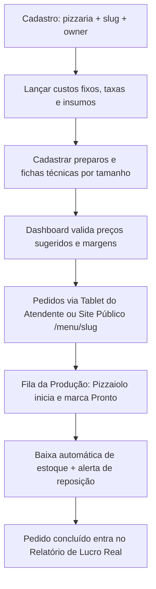

# 01 — Visão Geral do Sistema

## 1. Contexto

A oferta analisada (`empresaorganizada.com/precificacao-pizzaria`) vende uma
**planilha de precificação para pizzarias** por R$ 27,00. O dono de pizzaria
cadastra ingredientes, preparos, custos fixos e taxas, e a planilha devolve
custo, preço sugerido, lucro estimado e margem de cada pizza.

O problema real que o produto resolve:

> O dono de pizzaria calcula preço "olhando só o ingrediente", esquece
> embalagens, taxas, custos fixos e perdas, e acaba vendendo com margem menor
> que imagina — ou no prejuízo quando o fornecedor reajusta.

Este projeto transforma essa planilha em um **SaaS web multi-tenant**: cada
pizzaria se cadastra, lança seus custos e usa o sistema como fonte única de
precificação, com alertas quando a margem deixa de ser atingida.

## 2. Objetivo do produto

1. Calcular o **custo real** de cada pizza (ingredientes + preparos + embalagem + rateio de custos fixos + perdas).
2. Definir o **preço sugerido** a partir da margem desejada, já descontando taxas de cartão e delivery.
3. Mostrar **lucro estimado, margem % e status** (dentro da margem / precisa ajustar) de cada item.
4. Recalcular tudo **automaticamente** quando um custo mudar, gerando alertas.
5. Apoiar **pizzas mistas** (meio a meio, quatro sabores) e **combos com bebida**.
6. Oferecer **dashboard** com indicadores, rankings e consulta individual.
7. Controlar **estoque** de insumos (entradas, saídas, saldo, reposição).

## 3. Público-alvo

- Donos e gerentes de pizzarias (delivery e salão), em especial pequenos negócios.
- Perfil não técnico: a interface precisa ser simples, em português, com
  linguagem de negócio ("custo", "margem", "preço sugerido") e não de contabilidade.

## 4. Módulos do sistema

| # | Módulo | Descrição | MVP |
|---|--------|-----------|-----|
| 1 | **Ingredientes** | Cadastro de insumos com preço de compra, unidade e perda desperdício % | ✅ |
| 2 | **Preparos** | Receita base (massa, molho, frango desfiado) composta por ingredientes; custo unitário calculado | ✅ |
| 3 | **Custos fixos** | Aluguel, energia, equipe — com rateio por pizza ou % do faturamento | ✅ |
| 4 | **Taxas e delivery** | % cartão, % delivery e valor fixo de entrega na formação do preço | ✅ |
| 5 | **Produtos e tamanhos** | Sabores (pizza/bebida) e tamanhos (broto, média, grande, gigante) | ✅ |
| 6 | **Fichas técnicas** | Uma por sabor × tamanho: ingredientes/preparos + quantidades + embalagem → custo | ✅ |
| 7 | **Precificação** | Preço sugerido, lucro estimado, margem % e status por item | ✅ |
| 8 | **Pizzas mistas** | Meio a meio (2 sabores) e quatro sabores | ✅ |
| 9 | **Combos** | Pizza(s) + bebida(s) com custo e margem do conjunto | ✅ |
| 10 | **Bebidas** | Precificação simples de refrigerantes e acompanhamentos | ✅ |
| 11 | **Dashboard** | Indicadores gerais, rankings por lucro e custo, consulta individual | ✅ |
| 12 | **Alertas de reajuste** | Semáforo de margem e aviso quando custo mudar | ✅ |
| 13 | **Estoque** | Entradas, saídas, saldo, baixa automática por venda e alerta de reposição | ✅ |
| 14 | **Equipe e papéis** | Gestão de usuários (`owner`, `atendente`, `pizzaiolo`) por pizzaria | ✅ |
| 15 | **Pedidos e comanda** | Atendimento em tablet (balcão/retirada/entrega) + comanda térmica imprimível | ✅ |
| 16 | **Fila da produção** | Kanban em tempo real do pizzaiolo com receita resumida e alerta sonoro | ✅ |
| 17 | **Cardápio público** | Site mobile-first `/menu/{slug}` com checkout sem login e acompanhamento por código | ✅ |
| 18 | **Lucro real** | Consolidação financeira de vendas concluídas × custo real de insumos + rateio fixo | ✅ |

## 5. Personas

### Persona 1 — Dono da pizzaria (`owner`)
- Quer responder: "quanto custa, quanto cobrar e qual foi o meu lucro real no período?"
- Precisa ver rápido o que está no vermelho após um aumento de fornecedor e acompanhar o resultado líquido.
- Gerencia a equipe (`atendente` e `pizzaiolo`) e divulga o link público `/menu/{slug}`.

### Persona 2 — Atendente (`atendente`)
- Registra pedidos de balcão, retirada e delivery no tablet em menos de 1 minuto.
- Imprime a comanda térmica não fiscal e acompanha o status sem visualizar custos nem margens.

### Persona 3 — Pizzaiolo / Cozinha (`pizzaiolo`)
- Trabalha no kanban da fila de produção (`Recebido → Em preparo → Pronto`) com aviso sonoro.
- Consulta a receita resumida (quantidades da ficha técnica) e dá baixa automática no estoque ao concluir o preparo.

### Persona 4 — Cliente final (anônimo)
- Acessa `/menu/{slug}` pelo celular, monta pizzas inteiras ou meio a meio, escolhe combos/bebidas e acompanha o status pelo código de 6 caracteres.

## 6. Fluxo de uso principal (jornada do usuário)

## 7. Fora de escopo (v1)

- Emissão de nota fiscal eletrônica (NFC-e/NF-e/SAT) e gateway de pagamento online — a cobrança é feita na entrega/balcão com apoio da comanda térmica não fiscal.
- Integração com iFood/Rappi/POS externos — fica para versões futuras.
- Aplicativo nativo nas lojas — o Angular responsivo cobre desktop, tablet 10" e celular.
- Gestão contábil completa (contas a pagar/receber bancárias, conciliação OFX).
