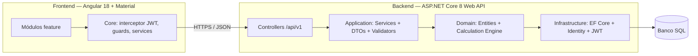
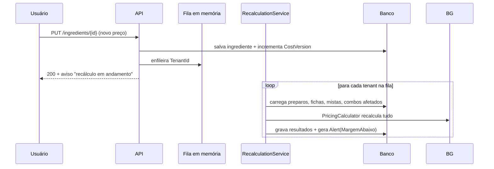

# 04 — Arquitetura

## 1. Visão de alto nível



## 2. Estrutura da solução (.NET)

```
backend/
├── PizzariaLucrativa.slnx
├── src/
│   ├── PizzariaLucrativa.Domain/          # sem dependência de framework
│   │   ├── Entities/                      # Ingredient, Preparation, TechnicalSheet...
│   │   ├── Enums/                         # Unit, AllocationType, MarginStatus...
│   │   ├── Services/                      # PricingCalculator, ProfitReportCalculator, StockUsageCalculator
│   │   └── Exceptions/                    # DomainException, CycleDetectedException
│   │
│   ├── PizzariaLucrativa.Application/     # casos de uso e contratos
│   │   ├── DTOs/
│   │   ├── Exceptions/                    # AppValidationException, ConflictException, NotFoundException
│   │   ├── Interfaces/                    # IIngredientService, ITenantProvider, IRecalculationQueue...
│   │   ├── Services/                      # implementações orquestradoras
│   │   ├── Validators/                    # FluentValidation
│   │   └── DependencyInjection.cs
│   │
│   ├── PizzariaLucrativa.Infrastructure/  # detalhe técnico e persistência
│   │   ├── Persistence/
│   │   │   ├── Configurations/            # IEntityTypeConfiguration<T> por entidade
│   │   │   ├── Migrations/
│   │   │   ├── AppDbContext.cs
│   │   │   ├── DatabaseInitializer.cs     # migração e seed de startup
│   │   │   ├── DemoSeeder.cs
│   │   │   └── RoleSeeder.cs
│   │   ├── Identity/                      # JwtTokenService, IdentityUserService
│   │   ├── Queues/                        # RecalculationChannel, RecalculationService
│   │   └── DependencyInjection.cs
│   │
│   └── PizzariaLucrativa.Api/             # HTTP e composição
│       ├── Controllers/
│       │   └── Shared/ApiControllerBase.cs # classe base [ApiController] + [Route("api/v{version:apiversion}/[controller]")]
│       ├── Extensions/                    # ApiServiceCollectionExtensions (Swagger, Auth, RateLimiting, CORS)
│       ├── Filters/                       # ValidationFilter
│       ├── Identity/                      # HttpContextTenantProvider
│       ├── Middleware/                    # ExceptionHandlingMiddleware, TenantContextMiddleware
│       └── Program.cs
│
└── tests/
    ├── PizzariaLucrativa.Domain.Tests/    # engine de cálculo (prioridade)
    └── PizzariaLucrativa.Api.Tests/       # integração + isolamento de tenant
```

**Regra de dependência**: `Domain` não referencia nada; `Application` referencia
`Domain`; `Infrastructure` referencia `Application` + `Domain`; `Api` referencia tudo.

## 3. Multi-tenancy por coluna

Decisão: **uma coluna `TenantId` (GUID)** em todas as tabelas de negócio +
**filtro global** no EF Core.

```
Fluxo:
1. Login → JWT carrega claim "tenant_id"
2. Middleware/HttpContext lê a claim → injeta em ITenantProvider (scoped)
3. AppDbContext aplica HasQueryFilter em todas as entidades TenantEntity base
4. SaveChangesAsync sobrescreve TenantId em inserts (não confiar no cliente)
```

Pontos-chave:
- `TenantEntity` é a classe base: `TenantId`, `CreatedAt`, `UpdatedAt`.
- O `TenantId` **nunca** vem do body do request.
- Teste obrigatório: usuário A não lista dados do usuário B (NF-T03).
- Prós/contras assumidos: implementação simples, custo baixo; escala vertical
  adequada ao público (pizzarias pequenas). Migração futura para
  schema-per-tenant fica documentada como evolução possível.

## 4. Autenticação e autorização

| Item | Decisão |
|------|---------|
| Provedor | ASP.NET Identity |
| Token access | JWT HS256, 15 min, claims: `sub`, `email`, `name`, `tenant_id`, `role` (+ `role_list`) |
| Refresh token | Valor aleatório 64 bytes, hash SHA256 no banco, 7 dias, rotacionado |
| Papéis | `owner`, `atendente`, `pizzaiolo` (seed idempotente no startup — `AppRoles`/`RoleSeeder`) |
| Políticas | `OwnerOnly`, `AtendenteOuOwner`, `ProducaoOuOwner` (ver docs/10, Sprint 1) |
| Endpoints públicos | `POST /auth/register` \| `/login` \| `/refresh`, `GET /api/v1/public/{slug}/...` |
| Demais endpoints | `[Authorize]` por padrão |

Papéis por área (docs/10):

| Área | Papéis |
|------|--------|
| Dashboard, pricing, fichas, custos, taxas, equipe, lucro, alertas | `owner` |
| Pedidos (tablet do atendente) | `owner`, `atendente` |
| Produção (fila do pizzaiolo) | `owner`, `pizzaiolo` |

O `TenantContextMiddleware` resolve o tenant em duas etapas:
1. claim `tenant_id` do JWT (rotas autenticadas);
2. segmento `{slug}` da rota pública `/api/v1/public/{slug}/...` (404 se o slug não
   existir — a validação é sempre contra o banco, nunca contra o corpo).

## 5. Recálculo em cadeia (background)



- `BackgroundService` consumindo `Channel<T>` (fila em memória) — simples e suficiente.
- Idempotente: rodar duas vezes produz o mesmo resultado.

## 6. Pipeline de requests

```
Request → ExceptionMiddleware → TenantMiddleware → Auth(JWT) → Controller
        → Application Service → Domain Service (cálculo) → EF Core → Banco
        → DTO de resposta (nunca expõe entidade direto)
```

## 7. Stack do frontend (resumo)

| Item | Decisão |
|------|---------|
| Framework | Angular 18 (standalone components, `@if`/`@for` novos) |
| UI | Angular Material 18 + tema customizado da marca |
| Estado | Serviços injetáveis + RxJS; NgRx fora do escopo (complexidade desnecessária) |
| HTTP | `HttpClient` com interceptor de JWT e interceptor de erros |
| Formulários | Reactive Forms em todos os cadastros |
| Gráficos | `ng2-charts` (Chart.js) para o dashboard |
| Build | `angular.json` com environments (dev/prod) |

Detalhamento no documento [08 — Frontend Angular](08-frontend-angular.md).

## 8. Decisões técnicas registradas (ADR resumido)

| # | Decisão | Alternativa descartada | Motivo |
|---|---------|------------------------|--------|
| ADR-1 | Multi-tenancy por coluna | Schema-per-tenant | Escopo pequeno, implementação simples, teste de isolamento factível |
| ADR-2 | Angular standalone + Material | NgRx | Aplicação CRUD; estado global simples não justifica store |
| ADR-3 | Cálculo em BackgroundService | Hangfire/Quartz | Volume baixo; Channel<T> resolve sem infra extra |
| ADR-4 | Margem sobre preço de venda | Markup sobre custo | Correto para delivery: taxas incidem sobre o preço cobrado |
| ADR-5 | Decimal(18,4) no banco | Float/double | Precisão monetária |
| ADR-6 | SQLite para dev, SQL Server para prod | — | Portabilidade no estudo, upgrade trivial via provider EF |
