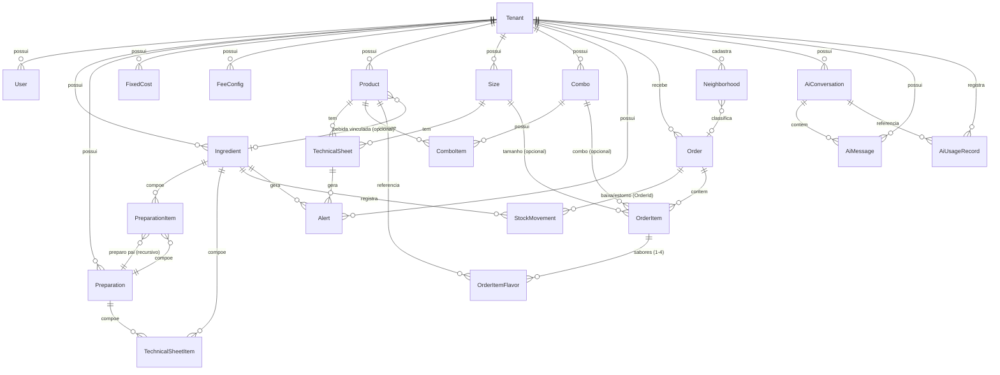

# 05 — Modelo de Dados

## 1. Diagrama Entidade-Relacionamento



## 2. Tabelas e campos

### Tenant (Pizzaria)
| Campo | Tipo | Obs |
|-------|------|-----|
| Id | GUID PK | |
| Name | varchar(120) | nome da pizzaria |
| Slug | varchar(40)? | único; usado nas rotas públicas `/public/{slug}` (Sprint 1) |
| CreatedAt / UpdatedAt | datetime2 | |

### User (Identity)
Extendida de `IdentityUser`: `TenantId` (GUID FK), `FullName`.
Papéis: `owner` / `atendente` / `pizzaiolo` (Sprint 1). Segurança: `roleGuard` no front e políticas no `Program.cs` (`OwnerOnly`, `AtendenteOuOwner`, `ProducaoOuOwner`).

### Ingredient
| Campo | Tipo | Obs |
|-------|------|-----|
| Id | GUID PK | |
| TenantId | GUID FK | |
| Name | varchar(120) | |
| PurchaseUnit | enum | `g`, `ml`, `un`, `kg`, `L` |
| PurchaseQuantity | decimal(18,4) | ex.: 5000 g do saco |
| PurchasePrice | decimal(18,4) | ex.: R$ 32,90 do saco |
| LossPercentage | decimal(5,2) | % perda, default 0 |
| UnitCost | decimal(18,4) | derivado: `PurchasePrice ÷ PurchaseQuantity × (1 + Loss%)` |
| MinimumStock | decimal(18,4) | estoque mínimo p/ alerta de reposição |
| CurrentStock | decimal(18,4) | saldo derivado dos movimentos |
| CostVersion | int | incrementa ao mudar preço → invalida cache |

### Preparation (receita base)
| Campo | Tipo | Obs |
|-------|------|-----|
| Id | GUID PK | |
| TenantId | GUID FK | |
| Name | varchar(120) | "Massa broto", "Molho de tomate" |
| YieldQuantity | decimal(18,4) | rendimento |
| YieldUnit | enum | `g`, `ml`, `un`, `porcao` |
| TotalCost | decimal(18,4) | derivado |
| UnitCost | decimal(18,4) | derivado: `TotalCost ÷ YieldQuantity` |

### PreparationItem
| Campo | Tipo | Obs |
|-------|------|-----|
| Id | GUID PK | |
| TenantId | GUID FK | |
| PreparationId | GUID FK | preparo dono do item |
| IngredientId | GUID? FK | um dos dois... |
| SourcePreparationId | GUID? FK | ...é preenchido (exclusivo) |
| Quantity | decimal(18,4) | |
| Unit | enum | unidade da quantidade |

> Constraint CHECK: exatamente um de `IngredientId` / `SourcePreparationId` não-nulo.
> `SourcePreparationId ≠ PreparationId` e a resolução recursiva detecta ciclos.

### FixedCost
| Campo | Tipo | Obs |
|-------|------|-----|
| Id | GUID PK | |
| TenantId | GUID FK | |
| Description | varchar(120) | "Aluguel", "Energia" |
| MonthlyValue | decimal(18,4) | |
| AllocationType | enum | `PerPizza`, `RevenuePercentage` |
| ExpectedPizzasPerMonth | int? | exigido se `PerPizza` |
| ExpectedMonthlyRevenue | decimal? | exigido se `RevenuePercentage` |

### FeeConfig (1 por tenant)
| Campo | Tipo | Obs |
|-------|------|-----|
| TenantId | GUID PK/FK | |
| CardFeePercentage | decimal(5,2) | ex.: 2,99 |
| DeliveryFeePercentage | decimal(5,2) | ex.: 25 (apps) ou 0 |
| DeliveryFixedValue | decimal(18,4) | valor fixo de entrega (opcional) |
| DefaultMarginPercentage | decimal(5,2) | margem desejada padrão, ex.: 60 |
| LossPercentageGlobal | decimal(5,2) | % perda global opcional |

### Product
| Campo | Tipo | Obs |
|-------|------|-----|
| Id | GUID PK | |
| TenantId | GUID FK | |
| Name | varchar(120) | "Calabresa" |
| Category | enum | `Pizza`, `Beverage`, `Other` |
| IsActive | bool | ocultar do cardápio sem excluir |
| IngredientId | GUID? FK | **bebida**: insumo debitado na venda (opcional; 1 un por bebida) |

### Size
| Campo | Tipo | Obs |
|-------|------|-----|
| Id | GUID PK | |
| TenantId | GUID FK | |
| Name | varchar(60) | "Broto", "Grande" |
| DiameterCm | int? | exibição |

### TechnicalSheet (produto × tamanho)
| Campo | Tipo | Obs |
|-------|------|-----|
| Id | GUID PK | |
| TenantId | GUID FK | |
| ProductId | GUID FK | |
| SizeId | GUID FK | |
| PackagingCost | decimal(18,4) | embalagem deste tamanho |
| LossPercentage | decimal(5,2)? | perda adicional da ficha |
| MarginPercentage | decimal(5,2)? | sobrescreve a padrão do tenant |
| DirectCost | decimal(18,4) | derivado |
| IndirectCost | decimal(18,4) | derivado (rateio fixos) |
| SuggestedPrice | decimal(18,4) | derivado |
| EstimatedProfit | decimal(18,4) | derivado |
| MarginPercentageReal | decimal(5,2) | derivado |
| MarginStatus | enum | `Within`, `NeedsAdjustment` |
| UNIQUE(TenantId, ProductId, SizeId) | | |

### TechnicalSheetItem
| Campo | Tipo | Obs |
|-------|------|-----|
| Id | GUID PK | |
| TenantId | GUID FK | |
| TechnicalSheetId | GUID FK | |
| IngredientId | GUID? FK | origem exclusiva... |
| PreparationId | GUID? FK | ...com TechnicalSheetItem |
| Quantity | decimal(18,4) | |
| UnitCostSnapshot | decimal(18,4) | custo unitário na data (auditoria) |
| ItemCost | decimal(18,4) | derivado |

### Combo
| Campo | Tipo | Obs |
|-------|------|-----|
| Id | GUID PK | |
| TenantId | GUID FK | |
| Name | varchar(120) | "Combo Família" |
| DiscountValue | decimal(18,4) | default 0 |
| FixedPrice | decimal(18,4)? | preço fechado (opcional) |
| TotalCost / TotalPrice / Profit / MarginPercentage / MarginStatus | derivados | |

### ComboItem
| Campo | Tipo | Obs |
|-------|------|-----|
| Id | GUID PK | |
| TenantId | GUID FK | |
| ComboId | GUID FK | |
| ProductId | GUID FK | |
| SizeId | GUID? FK | null para bebidas |
| Quantity | int | default 1 |

### StockMovement
| Campo | Tipo | Obs |
|-------|------|-----|
| Id | GUID PK | |
| TenantId | GUID FK | |
| IngredientId | GUID FK | |
| Type | enum | `In`, `Out`, `Adjustment`, `OrderOut` (baixa automática por pedido) |
| Quantity | decimal(18,4) | já convertida para a unidade de compra |
| UnitCost | decimal(18,4)? | só em `In` |
| OrderId | GUID? FK | pedido de origem (baixa/estorno) |
| Note | varchar(200)? | "Baixa do pedido #8F3K2Q" / "Estorno do pedido #8F3K2Q" |
| CreatedAt | datetime2 | |

### Order (pedido) — docs/10 Sprint 2
| Campo | Tipo | Obs |
|-------|------|-----|
| Id | GUID PK | |
| TenantId | GUID FK | |
| Code | varchar(6) | acompanhamento; alfabeto sem `O/0/I/1`; único por tenant na aplicação |
| Status | enum | `Received`, `InPreparation`, `Ready`, `OutForDelivery`, `Completed`, `Cancelled` |
| Type | enum | `Counter`, `Pickup`, `Delivery` |
| CustomerName / CustomerPhone | varchar(120/20)? | entrega exige nome e telefone |
| AddressDistrict / Street / Number / Complement | varchar(…)? | entrega exige distrito/rua/número |
| Subtotal / DeliveryFee / Discount / Total | decimal(18,4) | `Total = Subtotal + DeliveryFee − Discount` |
| Notes | varchar(500)? | |
| PaymentMethod | enum? | `Cash`, `Card`, `Pix` (P8 — opcional, só ticket/taxa) |
| PlacedByUserId | string(450)? | null = pedido público (site) |
| PlacedAt / StartedAt / ReadyAt / DeliveredAt / CancelledAt | datetime2 | |
| CancelReason | varchar(300)? | obrigatório ao cancelar |
| NeighborhoodId | GUID? FK | bairro do catálogo (`Neighborhoods`); nulo em balcão/retirada ou bairro não cadastrado (IA-1) |
| RegionSnapshot | enum? | região congelada no momento do pedido (`Center`, `North`, `South`, `East`, `West`, `Other`); nulo = “Não classificado” (IA-1) |

### OrderItem — docs/10 Sprint 2
| Campo | Tipo | Obs |
|-------|------|-----|
| Id | GUID PK | |
| TenantId | GUID FK | |
| OrderId | GUID FK | |
| SizeId | GUID? FK | null para bebida avulsa |
| ComboId | GUID? FK | exclusivo com sabores |
| Quantity | int | |
| UnitPrice | decimal(18,4) | snapshot do preço (ficha `CardPrice ?? SuggestedPrice`, ou `Combo.TotalPrice`) |
| CostSnapshot | decimal(18,4) | snapshot do custo (mista = média dos sabores) |
| Total | decimal(18,4) | `UnitPrice × Quantity` |
| Notes | varchar(300)? | |

### OrderItemFlavor — docs/10 Sprint 2
| Campo | Tipo | Obs |
|-------|------|-----|
| Id | GUID PK | |
| TenantId | GUID FK | |
| OrderItemId | GUID FK | |
| ProductId | GUID FK | |
| SharePercentage | decimal(5,2) | 1–4 sabores; soma = 100 (50/50 ou 25/25/25/25) |

> A baixa de estoque é gravada em `StockMovement(OrderOut)` (um por ingrediente)
> quando o pedido vira **Pronto** (P3); cancelar após Pronto grava um `In` de
> estorno (idempotente). O lucro real (Sprint 6) usa `OrderItem.CostSnapshot`.

### Alert
| Campo | Tipo | Obs |
|-------|------|-----|
| Id | GUID PK | |
| TenantId | GUID FK | |
| Type | enum | `MarginBelow`, `LowStock` |
| TechnicalSheetId | GUID? FK | |
| IngredientId | GUID? FK | |
| Message | varchar(300) | "Calabresa Grande: margem 42% < alvo 60%" |
| Status | enum | `Open`, `Resolved` |
| CreatedAt / ResolvedAt | datetime2 | |
| UNIQUE parcial: 1 alerta aberto por (tipo, item) | | evita spam a cada recálculo |

### Neighborhood (bairro/região) — IA-1/IA-2
| Campo | Tipo | Obs |
|-------|------|-----|
| Id | GUID PK | |
| TenantId | GUID FK | |
| Name | varchar(120) | obrigatório; unicidade por tenant garantida no `NeighborhoodService` (TPT) |
| Region | enum | `Center`, `North`, `South`, `East`, `West`, `Other` |
| IsActive | bool | desativa sem apagar histórico de pedidos |

> O pedido guarda `NeighborhoodId` e **congela** `RegionSnapshot`; remapear a região do
> bairro depois não altera relatórios históricos. Delivery sem bairro cadastrado mantém
> ambos nulos e é agrupado como “Não classificado”.

### AiConversation — IA-1/IA-3
| Campo | Tipo | Obs |
|-------|------|-----|
| Id | GUID PK | |
| TenantId | GUID FK | |
| UserId | varchar(450) | owner dono da conversa |
| Title | varchar(160) | título curto da listagem |
| IsArchived | bool | arquiva sem excluir |
| CreatedAt / UpdatedAt | datetime2 | herdados de `TenantEntity` |

### AiMessage — IA-1/IA-3
| Campo | Tipo | Obs |
|-------|------|-----|
| Id | GUID PK | |
| TenantId | GUID FK | |
| ConversationId | GUID FK | cascade ao excluir a conversa |
| Role | enum | `User`, `Assistant` |
| Content | varchar(8000) | texto da mensagem; sem payload bruto de tool por padrão |
| InputTokens / OutputTokens | int | consumo da mensagem |
| EstimatedCostUsd | decimal(18,4) | custo estimado |
| ToolsUsed | varchar(500)? | nomes das tools separados por vírgula |
| CreatedAt | datetime2 | herdado de `TenantEntity` |

### AiUsageRecord — IA-1/IA-3
| Campo | Tipo | Obs |
|-------|------|-----|
| Id | GUID PK | |
| TenantId | GUID FK | |
| UserId | varchar(450) | quem disparou a chamada |
| ConversationId | GUID? FK | `SET NULL` ao excluir a conversa; consumo permanece auditável |
| Provider / Model | varchar(40/80) | ex.: `Gemini` / `gemini-1.5-flash` |
| InputTokens / OutputTokens | int | tokens retornados pelo provedor |
| EstimatedCostUsd | decimal(18,4) | custo estimado da chamada |
| LatencyMs | int | latência observada |
| IsFallback | bool | resposta segura por timeout/429/orçamento |
| CreatedAt | datetime2 | herdado de `TenantEntity` |

> `AiUsageRecord` **não** guarda prompt nem conteúdo de mensagem. O histórico é sempre
> owner-only e isolado pelo query filter de tenant.

## 3. Índices recomendados

- `Ingredient (TenantId, Name)` — busca.
- `TechnicalSheet (TenantId, MarginStatus)` — dashboard/alertas.
- `StockMovement (TenantId, IngredientId, CreatedAt)` — saldo e relatórios.
- `StockMovement (OrderId)` — baixa/estorno por pedido.
- `Alert (TenantId, Status)` — lista de alertas.
- `Order (Code)` — busca pelo código de acompanhamento.
- `Order (Status, PlacedAt)` — fila da produção e listagem por dia.
- `Order (RegionSnapshot)` — analytics por região (IA-2).
- `Order (NeighborhoodId)` — vínculo com o catálogo de bairros.
- `Neighborhood (Name)` e `Neighborhood (Region)` — catálogo e agrupamento.
- `AiConversation (UserId)` — histórico do owner.
- `AiMessage (ConversationId)` — mensagens da conversa.
- `AiUsageRecord (UserId)` — consumo por usuário.
- `TenantEntity (TenantId, CreatedAt)` — índice compartilhado na tabela base TPT para
  histórico (`AiMessage.CreatedAt`) e orçamento (`AiUsageRecord.CreatedAt`).

> **Desvio consciente (TPT):** as entidades herdam `TenantEntity` (Id/TenantId/CreatedAt/
> UpdatedAt) em tabela base (Table-Per-Type), então os índices compostos que
> atravessam a base não são criáveis diretamente pelo EF (`Order(Code)` único/tenant,
> `Order(Status, CreatedAt)`). Foram adotados `Order (Code)` (não único, para lookup)
> e `Order (Status, PlacedAt)`. A **unicidade do código por tenant** é garantida no
> `OrderService` (checagem + geração com retry). Revisitar na Sprint 7 se o TPT for
> trocado por TPH.
>
> Pelo mesmo motivo, `CreatedAt` do histórico e do uso de IA é indexado na tabela base
> como `(TenantId, CreatedAt)` — o EF não materializa índice em propriedade herdada a
> partir da entidade derivada. A unicidade de `Neighborhood.Name` por tenant também é
> garantida no serviço, não por índice único composto.

## 4. Derivações (não são verdade fonte)

Campos calculados (`UnitCost`, `DirectCost`, `SuggestedPrice`...) são
**persistidos** para leitura rápida no dashboard, mas a **verdade fonte são os
insumos**. Toda alteração de custo dispara o recálculo em cadeia (ver
[04 — Arquitetura, §5](04-arquitetura.md)).

## 5. Exemplo numérico de referência (usar nos testes)

```
Ingrediente: Muçarela — compra 5000 g a R$ 32,90, perda 3%
UnitCost = 32,90 ÷ 5000 × 1,03 = R$ 0,006798/g

Preparo: Massa broto — rendimento 10 unidades de 250 g
  3000 g farinha  × 0,0025 = 7,50
  1900 g água     × 0,0000 = 0,00
   200 g fermento × 0,0180 = 3,60
  Total = 11,10 → UnitCost = 1,11/un

Ficha: Calabresa Broto
  Massa broto      1 un   = 1,11
  Muçarela       180 g    = 1,22
  Calabresa      100 g    = 0,95
  Embalagem       1 un    = 0,60
  DirectCost            = 3,88

Custos fixos: R$ 3.200/mês ÷ 2.500 pizzas = R$ 1,28 → IndirectCost = 1,28
Taxas: cartão 2,99% + delivery 0% ; Margem alvo 60%

SuggestedPrice = (3,88 + 1,28) ÷ (1 − 0,60 − 0,0299) = 5,16 ÷ 0,3701 = R$ 13,94
Lucro   = 13,94 − 5,16 − (2,99% × 13,94 = 0,42) = R$ 8,36
Margem% = 8,36 ÷ 13,94 = 60,0%  →  Within ✅
```
