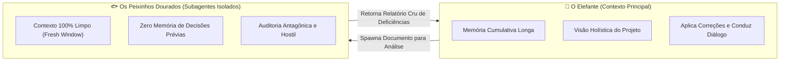
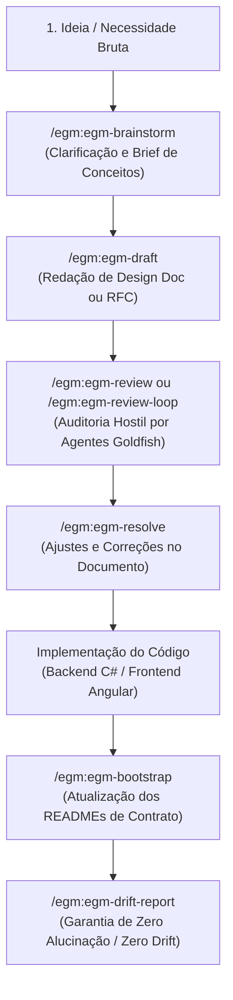

# Guia Prático das Skills EGM (Elephant-and-Goldfish Model)

> Este guia documenta o ecossistema de habilidades (**Skills**) e personas do plugin **EGM (Elephant-and-Goldfish Model)** no ambiente do Google Antigravity, explicando seus conceitos, fluxos de trabalho, personas especializadas e exemplos práticos para o dia a dia de engenharia no **Pizzaria Lucrativa**.

---

## 📌 Sumário

1. [O Que é o Modelo EGM?](#-1-o-que-é-o-modelo-egm)
2. [A Metáfora: Elefante vs. Peixinho Dourado](#-2-a-metáfora-elefante-vs-peixinho-dourado)
3. [Visão Geral das Skills EGM](#-3-visão-geral-das-skills-egm)
4. [Ciclo de Vida de uma Funcionalidade (Workflow Recomendado)](#-4-ciclo-de-vida-de-uma-funcionalidade-workflow-recomendado)
5. [Detalhamento das Skills](#-5-detalhamento-das-skills)
   - [5.1 `egm-brainstorm` (Ideação & Refinamento)](#51-egm-brainstorm-ideação--refinamento)
   - [5.2 `egm-draft` (Redação de Especificações Técnicas)](#52-egm-draft-redação-de-especificações-técnicas)
   - [5.3 `egm-review` (Revisão Especializada Multi-Persona)](#53-egm-review-revisão-especializada-multi-persona)
   - [5.4 `egm-resolve` (Resolução Interativa de Apontamentos)](#54-egm-resolve-resolução-interativa-de-apontamentos)
   - [5.5 `egm-review-loop` (Loop Autônomo de Revisão e Correção)](#55-egm-review-loop-loop-autônomo-de-revisão-e-correção)
   - [5.6 `egm-bootstrap` (Contratos de Código Peanuts & Hay)](#56-egm-bootstrap-contratos-de-código-peanuts--hay)
   - [5.7 `egm-drift-report` (Auditoria de Consistência Código ⟷ Docs)](#57-egm-drift-report-auditoria-de-consistência-código--docs)
6. [Personas e Subagentes Revisores](#-6-personas-e-subagentes-revisores)
7. [Exemplos Práticos no Projeto Pizzaria Lucrativa](#-7-exemplos-práticos-no-projeto-pizzaria-lucrativa)
   - [Cenário A: Criar Nova Integração (ex: Pix com Webhook)](#cenário-a-criar-nova-integração-ex-pix-com-webhook)
   - [Cenário B: Revisar um Documento Técnico Existente](#cenário-b-revisar-um-documento-técnico-existente)
   - [Cenário C: Auditar Divergências após Refatoração](#cenário-c-auditar-divergências-após-refatoração)
8. [Boas Práticas e Dicas de Produtividade](#-8-boas-práticas-e-dicas-de-produtividade)

---

## 🐘 1. O Que é o Modelo EGM?

O **Elephant-and-Goldfish Model (EGM)** foi concebido para resolver o maior gargalo do desenvolvimento assistido por Inteligência Artificial: **perda de contexto, viés de confirmação e alucinação cumulativa** em conversas longas.

Em vez de permitir que um único agente trabalhe com premissas presumidas e sem escrutínio, o EGM estabelece uma separação rigorosa entre:
1. **Quem gerencia o projeto** (mantém o histórico acumulado).
2. **Quem desafia e audita o projeto** (olha para o documento como um leitor hostil, crítico e sem viés de contexto anterior).

---

## 🐟 2. A Metáfora: Elefante vs. Peixinho Dourado



- **O Elefante (Elephant)**: É a sessão principal do agente (orquestrador). Possui histórico longo, entende as conversas anteriores e interage com o usuário para tomar decisões.
- **O Peixinho Dourado (Goldfish)**: São subagentes especialistas criados com uma **janela de contexto 100% limpa** (`invoke_subagent`). Eles leem *apenas* o documento ou código fornecido, sem herdar premissas da conversa. Se algo não estiver explicitamente escrito no documento, o Goldfish aponta como erro ou ambiguidade.
- **Peanuts (Amendoins)**: Contratos `README.md` de nível folha (componentes de código com classes, funções, invariantes e efeitos colaterais concretos).
- **Hay (Feno)**: Blueprints `README.md` de nível intermediário e raiz (índices agregadores de alto nível).

---

## 🧰 3. Visão Geral das Skills EGM

O plugin EGM disponibiliza 7 habilidades integradas:

| Comando / Skill | Função Principal | Quando Utilizar |
|---|---|---|
| `/egm:egm-brainstorm` | Ideação interativa e elaboração de hipóteses | Ao planejar uma funcionalidade antes de ter um plano fechado |
| `/egm:egm-draft` | Redação orientada a seções de documentos técnicos | Ao escrever um RFC, ADR ou design doc estruturado |
| `/egm:egm-review` | Escrutínio antagônico por personas Goldfish | Ao validar se um design doc está completo, seguro e viável |
| `/egm:egm-resolve` | Resolução interativa de pendências de revisão | Para sanar apontamentos do relatório de revisão |
| `/egm:egm-review-loop` | Loop automatizado de auditoria + auto-correção | Para documentos críticos que precisam de múltiplas rodadas de polimento |
| `/egm:egm-bootstrap` | Geração de contratos `README.md` Peanuts & Hay | Ao mapear a arquitetura da base de código e criar contratos vivos |
| `/egm:egm-drift-report` | Detector de divergência código ⟷ documentação | Para verificar se o código implementado divergiu das especificações |

---

## 🔄 4. Ciclo de Vida de uma Funcionalidade (Workflow Recomendado)

Ao criar uma nova feature de média ou alta complexidade no **Pizzaria Lucrativa**, o fluxo padrão do EGM segue as etapas abaixo:



---

## 📖 5. Detalhamento das Skills

### 5.1 `egm-brainstorm` (Ideação & Refinamento)

- **Objetivo**: Converte conceitos abstratos ou requisitos vagos em um documento de hipóteses estruturado (`concepts_brief.md`).
- **Como Funciona**: Faz perguntas direcionadas ao usuário para sanar ambiguidades e, em seguida, dispara um subagente Goldfish para desafiar a premissa de valor da solução.
- **Como Invocar**:
  ```text
  /egm:egm-brainstorm Quero adicionar pagamento Pix dinâmico no cardápio público
  ```
- **Saída**: Cria o artefato `concepts_brief.md` contendo:
  - Problema real e dores atacadas.
  - Alternativas consideradas e descartadas.
  - Decisão arquitetural recomendada.
  - Perguntas em aberto.

---

### 5.2 `egm-draft` (Redação de Especificações Técnicas)

- **Objetivo**: Constrói um documento técnico completo (*Design Doc*, RFC ou plano arquitetural) seção por seção, seguindo os padrões rigorosos de engenharia do Google.
- **Como Funciona**: Lê o `concepts_brief.md` gerado no brainstorm (ou suas notas) e rascunha seções padronizadas: Contexto, Metas / Não-Metas, Arquitetura Proposta, Modelo de Dados, Riscos e Plano de Migração.
- **Como Invocar**:
  ```text
  /egm:egm-draft docs/designs/pix-pagamento-dinamico.md
  ```
- **Regra Importante**: O draft nunca é despejado como parede de texto no chat; ele é gravado diretamente no arquivo de destino ou em artefato.

---

### 5.3 `egm-review` (Revisão Especializada Multi-Persona)

- **Objetivo**: Executa a auditoria antagônica oficial do EGM disparando personas especializadas em paralelo.
- **Fases de Revisão**:
  1. **Initial Zoom Out**: Minimalismo, YAGNI e reuso de bibliotecas existentes.
  2. **Comprehension Review**: Clareza para leitores sem contexto prévio.
  3. **Design Critique**: Escalabilidade, concorrência, gargalos e segurança.
  4. **Codebase Details**: Aderência estrita à estrutura real do repositório.
  5. **Implementation Readiness**: Se o plano está 100% pronto para um desenvolvedor codificar sem hesitar.
- **Como Invocar**:
  ```text
  /egm:egm-review docs/designs/pix-pagamento-dinamico.md
  ```
- **Saída**: Um relatório estruturado de apontamentos contendo severidades (`BLOCKER`, `WARNING`, `NIT`) e propostas de fix (`PROPOSE FIX`).

---

### 5.4 `egm-resolve` (Resolução Interativa de Apontamentos)

- **Objetivo**: Processa o relatório de apontamentos do `egm-review`, apresentando opções interativas para o desenvolvedor aceitar, rejeitar ou negociar cada recomendação.
- **Como Invocar**:
  ```text
  /egm:egm-resolve docs/designs/pix-pagamento-dinamico.md
  ```
- **Comportamento**: Edita cirurgicamente o documento de design para sanar as fragilidades apontadas pelos revisores.

---

### 5.5 `egm-review-loop` (Loop Autônomo de Revisão e Correção)

- **Objetivo**: Une o `egm-review` e o `egm-resolve` em uma esteira contínua e iterativa até que o documento atinja nota máxima de qualidade ou zero bloqueadores.
- **Quando Usar**: Para especificações arquiteturais críticas ou PRDs fundamentais do sistema.
- **Como Invocar**:
  ```text
  /egm:egm-review-loop docs/designs/pix-pagamento-dinamico.md
  ```

---

### 5.6 `egm-bootstrap` (Contratos de Código Peanuts & Hay)

- **Objetivo**: Varre a árvore de diretórios do repositório e gera arquivos `README.md` em padrão EGM para cada módulo e pacote folha de código.
- **O Que Cada README Folha Contém**:
  - `## Overview`: Papel arquitetural do módulo.
  - `## Interface`: Símbolos públicos (classes, métodos, rotas, tipos, componentes).
  - `## Invariants`: Restrições de estado e regras de negócio inegociáveis.
  - `## Side Effects`: Acessos a banco, requisições HTTP, mutações de cache ou estado de tela.
  - `## Verification`: Comando exato de teste (`dotnet test` ou `npm test`).
- **Como Invocar**:
  ```text
  /egm:egm-bootstrap .
  ```
  *(Também pode ser executado em uma subpasta específica, ex: `/egm:egm-bootstrap backend/src/PizzariaLucrativa.Domain`)*.

---

### 5.7 `egm-drift-report` (Auditoria de Consistência Código ⟷ Docs)

- **Objetivo**: Garante que a documentação técnica e os contratos `README.md` não fiquem desatualizados após refatorações no código.
- **O Que Detecta**:
  - Símbolos citados na documentação que foram removidos ou renomeados.
  - Novas rotas ou classes públicas que não possuem documentação correspondente.
  - Regras e invariantes que não correspondem mais ao comportamento real.
- **Como Invocar**:
  ```text
  /egm:egm-drift-report .
  ```
- **Saída**: Gera o arquivo `{YYYY-MM-DD}_DRIFT_REPORT.md` detalhando discrepâncias encontradas ou atestando `No drift detected`.

---

## 👥 6. Personas e Subagentes Revisores

Durante a execução das skills de revisão (`egm-review`, `egm-review-loop`, `egm-bootstrap`), o harness do Antigravity ativa as seguintes personas:

```
┌────────────────────────────────────────────────────────────────────────┐
│                        SUÍTE DE AUDITORES EGM                          │
├────────────────────────┬───────────────────────────────────────────────┤
│ Persona                │ Foco de Avaliação                             │
├────────────────────────┼───────────────────────────────────────────────┤
│ egm-zoom-out           │ Simplificação, YAGNI, evitar superengenharia  │
│ egm-comprehension      │ Clareza para novatos, termos não explicados   │
│ egm-design             │ Gargalos de I/O, concorrência, falhas de rede │
│ egm-codebase-details   │ Precisão em arquivos, classes e endpoints     │
│ egm-implementation-readiness │ Detalhamento de passos para o codificador│
│ egm-structural         │ Diagramas válidos, tabelas e padrões de cabeço│
│ egm-style              │ Concisão, objetividade e eliminação de prolixidade│
│ egm-synthesizer        │ Deduplicação e compilação do relatório final  │
└────────────────────────┴───────────────────────────────────────────────┘
```

---

## 🎯 7. Exemplos Práticos no Projeto Pizzaria Lucrativa

### Cenário A: Criar Nova Integração (ex: Pix com Webhook)

1. **Passo 1 (Brainstorming da Ideia)**:
   ```text
   /egm:egm-brainstorm Precisamos integrar cobrança Pix instantânea via Mercado Pago ou Efí Bank no cardápio público da pizzaria com confirmação automática do pedido via webhook.
   ```
2. **Passo 2 (Redigir o Design Doc)**:
   ```text
   /egm:egm-draft docs/14-integracao-pagamento-pix.md
   ```
3. **Passo 3 (Auditoria Antagônica)**:
   ```text
   /egm:egm-review docs/14-integracao-pagamento-pix.md
   ```
4. **Passo 4 (Ajustar o Documento)**:
   ```text
   /egm:egm-resolve docs/14-integracao-pagamento-pix.md
   ```
5. **Passo 5 (Codificar a Funcionalidade)**:
   - Implementar nos projetos `Domain`, `Application`, `Infrastructure`, `Api` e `frontend`.
6. **Passo 6 (Atualizar Contratos)**:
   ```text
   /egm:egm-bootstrap backend/src/PizzariaLucrativa.Infrastructure/Persistence
   ```

---

### Cenário B: Revisar um Documento Técnico Existente

Se você quiser auditar se algum dos documentos em `docs/` tem falhas lógicas, furos de segurança ou falta de detalhes:

```text
/egm:egm-review docs/06-regras-de-negocio.md
```
O agente invocará os revisores Goldfish e gerará um relatório apontando inconsistências nas fórmulas, casos de borda não tratados e sugestões de melhoria.

---

### Cenário C: Auditar Divergências após Refatoração

Sempre que concluir uma sprint com muitas alterações de classes, métodos ou controllers, rode:

```text
/egm:egm-drift-report .
```
O relatório indicará se algum contrato `README.md` cita métodos que mudaram de assinatura ou tabelas modificadas.

---

## 💡 8. Boas Práticas e Dicas de Produtividade

1. **Evite Polling Manual**: Os subagentes Goldfish rodam de forma reativa e notificam o agente principal assim que terminam. Não é necessário esperar ou enviar mensagens adicionais durante o processamento paralelo.
2. **Preserve Notas Manuais**: O `egm-bootstrap` adota uma política estrita de preservação: ao atualizar um `README.md` existente, ele incorpora os dados de contrato sem apagar introduções, sumários ou guias criados por humanos.
3. **Isolamento de Git**: As skills EGM **nunca realizam `git commit`**. Elas escrevem as alterações no disco local para que você possa inspecionar o `git diff` antes de versionar.
4. **Respeite os Portões de Segurança**: Quando uma operação envolver mais de 15 pastas, o `egm-bootstrap` sempre solicitará sua confirmação antes de disparar agentes em massa.
