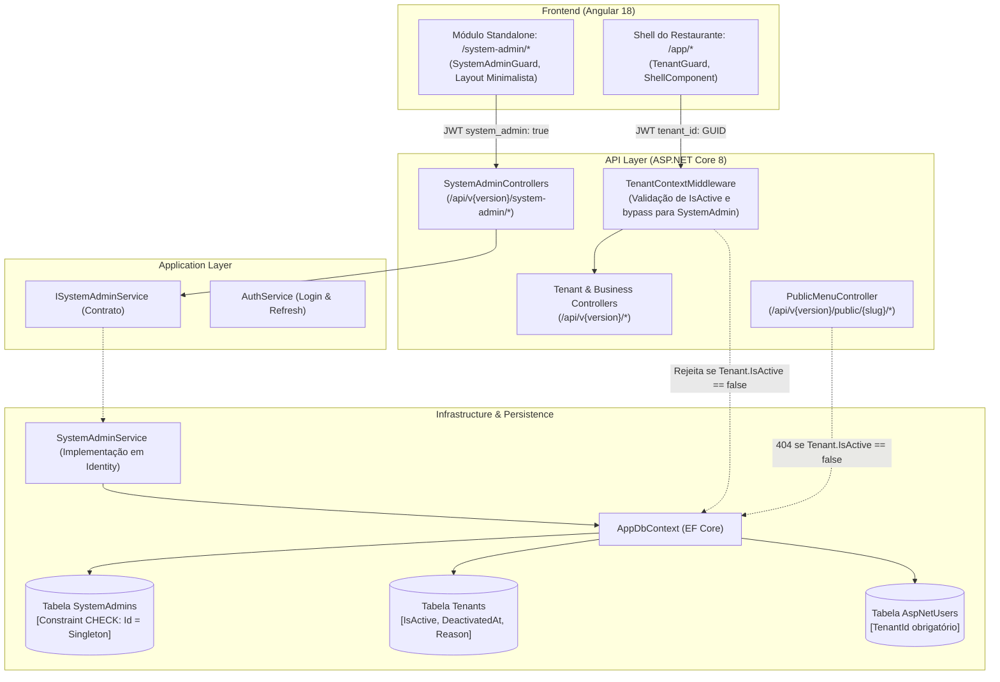
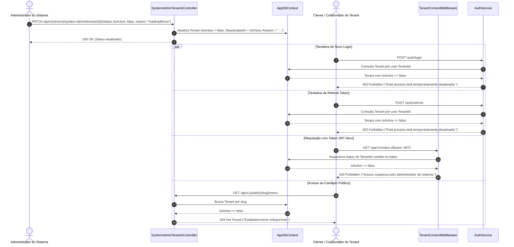

# Governança Global de Tenants e Ciclo de Vida do Administrador do Sistema

*   **Author:** Antigravity EGM Architecture
*   **Status:** Approved
*   **Date:** 2026-11-05

--------------------------------------------------------------------------------

## Overview

O *PizzariaLucrativa* é uma plataforma SaaS multi-tenant voltada para gestão operacional, custos e precificação de pizzarias. Cada pizzaria cadastrada opera isoladamente por meio de sua chave de tenant (`TenantId`), onde o dono do restaurante (`Tenant Owner`) administra seu catálogo de insumos, fichas técnicas, pedidos e colaboradores.

Este documento estabelece o design técnico definitivo para o Módulo de Governança Global do Dono da Plataforma (Administrador do Sistema). A iniciativa introduz um domínio administrativo segregado, garantindo visibilidade centralizada sobre todas as pizzarias registradas na plataforma, controle de ciclo de vida com corte imediato para estabelecimentos desativados, e aplicação rigorosa da regra de cardinalidade unitária (estritamente 1 Administrador do Sistema).

--------------------------------------------------------------------------------

## The Problem

Atualmente, o sistema apresenta três deficiências estruturais de governança:

1. **Invisibilidade Operacional do Dono da Plataforma:**
   O proprietário do SaaS não dispõe de endpoints ou interface para listar e auditar quais pizzarias foram criadas. O onboarding é descentralizado, mas a plataforma não oferece visibilidade de quem são os responsáveis, slugs e datas de criação dos estabelecimentos.

2. **Incapacidade de Moderação e Suspensão Administrativa:**
   Não existe modelagem de estado operacional na entidade `Tenant`. Uma pizzaria inadimplente ou sob violação de termos continua com cardápio público ativo, colaboradores autenticando e pedidos sendo processados normalmente, sem possibilidade de bloqueio pelo administrador do sistema.

3. **Acoplamento de Identidade e Risco de Escalada de Privilégios:**
   A identidade de usuário (`AppUser`) impõe a presença de um `TenantId` não-nulo obrigatório. Não há segregação física entre usuários do restaurante e o administrador da infraestrutura. Se um papel administrativo global for incluído no catálogo padrão (`AppRoles`), donos de pizzarias poderão autoatribuir permissões de sistema aos seus colaboradores através do `UserAdminService`.

--------------------------------------------------------------------------------

## Goals

*   **G-1 (Visibilidade Centralizada):** Fornecer API autenticada e interface web para o Administrador do Sistema listar todas as pizzarias cadastradas com informações mínimas essenciais: Nome da Pizzaria, Slug, Data de Criação, Responsável (Nome e E-mail) e Status Operacional (`Ativo`/`Desativado`).
*   **G-2 (Corte Imediato e Absoluto de Operações):** Implementar capacidade de suspensão imediata de tenants com efeito simultâneo em autenticação (login 403 e refresh 403), middleware de requisições ativas (403) e cardápio digital público (404/indisponível).
*   **G-3 (Invariante de Administrador Único):** Garantir, via restrição determinística `CHECK` no banco de dados e validações em camada de aplicação, a existência de no máximo e exatamente 1 conta física de Administrador do Sistema.
*   **G-4 (Segregação Estrita de Domínio e Identidade):** Separar fisicamente a entidade `SystemAdmin` da tabela de colaboradores `AspNetUsers`, garantindo que donos de pizzarias jamais acessem rotas do sistema nem possam se promover a administradores globais.
*   **G-5 (Recuperação de Credenciais Híbrida e Resiliente):** Prover recuperação de senha via comando administrativo local no servidor (CLI break-glass com suporte a entrada mascarada de senha) como mecanismo de contingência primário imune a falhas de rede, complementado por solicitação web temporária com geração de token seguro.

--------------------------------------------------------------------------------

## Non-Goals

*   **NG-1 (Tenant Impersonation / Ghost Login):** Permitir que o Administrador do Sistema faça login em nome do dono da pizzaria para intervir em pedidos ou fichas técnicas (risco de conformidade e violação de privacidade).
*   **NG-2 (Faturamento e Cobrança Automática Integrada):** Integração com gateways de pagamento (Stripe, Asaas) para suspensão automática baseada em webhook de cartão (escopo de faturamento futuro).
*   **NG-3 (Múltiplos Níveis Hierárquicos de Suporte):** Criação de papéis granulares de plataforma (suporte N1, N2, auditor). O escopo é restrito exclusivamente a 1 conta raiz.
*   **NG-4 (Exclusão Física de Dados - Hard Delete):** Deletar registros relacionais ou tabelas de tenants suspensos. A desativação é estritamente lógica para preservar histórico fiscal e transacional.
*   **NG-5 (Métricas Financeiras Detalhadas no Painel Global):** Exibir faturamento individual, lucro bruto ou volume financeiro de vendas de cada pizzaria na tabela de governança.

--------------------------------------------------------------------------------

## Open Questions

*Nenhuma questão aberta. Todos os pontos de arquitetura, integridade de dados e corte imediato foram validados e reconciliados.*

--------------------------------------------------------------------------------

## Critical User Journeys (CUJs)

### CUJ 1: Dono do Sistema Consulta as Pizzarias Cadastradas

*   **Given**: O Administrador do Sistema está autenticado na plataforma através da rota exclusiva `/system-admin/login`.
*   **When**: O administrador acessa o painel `/system-admin/tenants`.
*   **Then**: O sistema apresenta uma listagem paginada contendo Nome, Slug, Data de Criação, Responsável (Nome e E-mail) e o Status (`Ativo`/`Desativado`) de todas as pizzarias registradas, permitindo busca por nome ou slug.

### CUJ 2: Dono do Sistema Desativa uma Pizzaria com Corte Imediato

*   **Given**: Uma pizzaria cadastrada está ativa (`IsActive = true`) e o Administrador do Sistema decide suspendê-la fora do horário de funcionamento.
*   **When**: O administrador aciona o botão de desativação, confirma a ação no modal e informa a justificativa administrativa.
*   **Then**: O status do tenant é alterado para `IsActive = false`, registrando data e motivo. A partir da confirmação da transação:
    1. Tentativas de login por colaboradores da pizzaria são rejeitadas com HTTP 403 Forbidden.
    2. Tentativas de renovação de sessão (`POST /auth/refresh`) são rejeitadas com HTTP 403 Forbidden.
    3. Requisições em andamento com tokens emitidos para aquele `TenantId` são interceptadas no middleware com HTTP 403 Forbidden.
    4. O cardápio público (`/api/v1/public/{slug}/...`) responde com HTTP 404 Not Found (estabelecimento indisponível).

### CUJ 3: Dono do Sistema Reativa uma Pizzaria

*   **Given**: Uma pizzaria cadastrada está suspensa (`IsActive = false`).
*   **When**: O Administrador do Sistema aciona o botão de reativação no painel `/system-admin/tenants`.
*   **Then**: O sistema atualiza o tenant para `IsActive = true`, limpa `DeactivatedAt` e `DeactivationReason` para `null`, e restaura imediatamente o acesso a logins, renovações de token e cardápio digital.

### CUJ 4: Recuperação de Senha do Administrador via CLI (Break-Glass)

*   **Given**: O Administrador do Sistema esqueceu sua senha ou a interface web está inacessível.
*   **When**: O administrador acessa o terminal/SSH do servidor e executa o comando CLI:
    ```bash
    dotnet run --project backend/src/PizzariaLucrativa.Api -- --reset-system-admin --email "admin@plataforma.com" --password "NovaSenhaForte123!"
    ```
    *(Ou omite `--password` para digitar a senha em prompt mascarado no console).*
*   **Then**: A rotina valida o comando localmente, atualiza o hash PBKDF2 na entidade `SystemAdmin`, limpa tokens de reset pendentes, exibe mensagem de sucesso e encerra o processo com código 0 sem inicializar o servidor Kestrel.

--------------------------------------------------------------------------------

## Technical Plan (Architecture)

### 1. Topologia de Componentes e Limites de Domínio

A arquitetura preserva estritamente os princípios de Clean Architecture da solução, segregando as responsabilidades de plataforma e de restaurante em camadas independentes:



### 2. Modelagem de Dados e Persistência

#### 2.1. Entidade `Tenant` Atualizada (`Domain/Entities/Tenant.cs`)
Adição de propriedades de controle de ciclo de vida com valores padrão seguros:
```csharp
namespace PizzariaLucrativa.Domain.Entities;

public class Tenant
{
    public Guid Id { get; set; } = Guid.NewGuid();
    public string Name { get; set; } = string.Empty;
    public string? Slug { get; set; }

    // Governança Administrativa
    public bool IsActive { get; set; } = true;
    public DateTime? DeactivatedAt { get; set; }
    public string? DeactivationReason { get; set; }

    public DateTime CreatedAt { get; set; } = DateTime.UtcNow;
    public DateTime? UpdatedAt { get; set; }
}
```

#### 2.2. Entidade Autônoma `SystemAdmin` (`Domain/Entities/SystemAdmin.cs`)
Entidade desacoplada de `TenantEntity` e de `IdentityUser`, garantindo zero dependência de `TenantId`:
```csharp
namespace PizzariaLucrativa.Domain.Entities;

public class SystemAdmin
{
    public static readonly Guid SingletonId = Guid.Parse("00000000-0000-0000-0000-000000000001");

    public Guid Id { get; set; } = SingletonId;
    public string Email { get; set; } = string.Empty;
    public string PasswordHash { get; set; } = string.Empty;
    public string FullName { get; set; } = string.Empty;

    // Recuperação de senha temporária
    public string? PasswordResetTokenHash { get; set; }
    public DateTime? PasswordResetTokenExpiresAt { get; set; }

    public DateTime CreatedAt { get; set; } = DateTime.UtcNow;
    public DateTime? UpdatedAt { get; set; }
    public DateTime? LastLoginAt { get; set; }
}
```

#### 2.3. Mapeamento EF Core e Invariante de Unicidade Rígida (`Infrastructure/Persistence/Mappings/SystemAdminMap.cs`)
A garantia física de cardinalidade unitária é imposta diretamente no banco de dados via Check Constraint formal, impedindo a inserção de qualquer registro cujo `Id` divirja do GUID determinístico singleton:
```csharp
using Microsoft.EntityFrameworkCore;
using Microsoft.EntityFrameworkCore.Metadata.Builders;
using PizzariaLucrativa.Domain.Entities;

namespace PizzariaLucrativa.Infrastructure.Persistence.Mappings;

public class SystemAdminMap : IEntityTypeConfiguration<SystemAdmin>
{
    public void Configure(EntityTypeBuilder<SystemAdmin> builder)
    {
        builder.ToTable("SystemAdmins", t =>
        {
            // Garante matematicamente no banco que NUNCA poderá existir mais de 1 linha física
            t.HasCheckConstraint("CK_SystemAdmins_Singleton", "Id = '00000000-0000-0000-0000-000000000001'");
        });

        builder.HasKey(x => x.Id);
        builder.Property(x => x.Id).ValueGeneratedNever();

        builder.Property(x => x.Email)
            .IsRequired()
            .HasMaxLength(256);

        builder.HasIndex(x => x.Email).IsUnique();
        builder.Property(x => x.FullName).IsRequired().HasMaxLength(120);
        builder.Property(x => x.PasswordHash).IsRequired();
    }
}
```

### 3. Pipeline de Interceptação e Corte Imediato

O bloqueio por desativação opera de forma atômica e em cascata:



### 4. Especificação de Contratos de API (`SystemAdmin`)

Todos os endpoints operam sob a política `[Authorize(Policy = "SystemAdminOnly")]`, com exceção das rotas de autenticação:

| Método | Rota | Autenticação | Descrição |
| :--- | :--- | :--- | :--- |
| `POST` | `/api/v{version:apiVersion}/system-admin/auth/login` | Anônimo | Autenticação com e-mail/senha. Retorna JWT com claim `system_admin = true`. |
| `POST` | `/api/v{version:apiVersion}/system-admin/auth/forgot-password` | Anônimo | Solicita token de reset. Retorno 200 OK genérico anti-enumeração. |
| `POST` | `/api/v{version:apiVersion}/system-admin/auth/reset-password` | Anônimo | Redefine a senha fornecendo o token recebido e a nova senha. |
| `GET` | `/api/v{version:apiVersion}/system-admin/tenants` | `SystemAdminOnly` | Listagem paginada (`page`, `pageSize`, `search`, `isActive`). |
| `PATCH` | `/api/v{version:apiVersion}/system-admin/tenants/{id}/status` | `SystemAdminOnly` | Altera status (`isActive: bool`, `reason: string?`). |

#### Formato dos DTOs:
```csharp
namespace PizzariaLucrativa.Application.DTOs;

public sealed record TenantListItemDto(
    Guid Id,
    string Name,
    string? Slug,
    DateTime CreatedAt,
    string OwnerName,
    string OwnerEmail,
    bool IsActive,
    DateTime? DeactivatedAt,
    string? DeactivationReason
);

public sealed record TenantStatusUpdateInput(bool IsActive, string? Reason);
public sealed record SystemAdminLoginInput(string Email, string Password);
public sealed record SystemAdminAuthResultDto(string Token, DateTime ExpiresAt, string Email, string FullName);
public sealed record ForgotPasswordInput(string Email);
public sealed record ResetPasswordInput(string Token, string NewPassword);
```

#### Resolução do Proprietário na Listagem de Tenants:
Para evitar problemas de N+1 queries ou falhas relacionais, o método `GetTenantsAsync` executa uma projeção LINQ determinística:
```csharp
var query = from t in _db.Set<Tenant>().AsNoTracking()
            join u in _db.Set<AppUser>().AsNoTracking() on t.Id equals u.TenantId into users
            from owner in users.OrderBy(u => u.CreatedAt).Take(1).DefaultIfEmpty()
            select new TenantListItemDto(
                t.Id,
                t.Name,
                t.Slug,
                t.CreatedAt,
                owner != null ? owner.FullName : "Sem proprietário",
                owner != null ? owner.Email ?? "" : "",
                t.IsActive,
                t.DeactivatedAt,
                t.DeactivationReason
            );
```

### 5. Mecanismo de Recuperação de Credenciais

1. **Via Console/CLI no Servidor (Break-Glass - Primário e Resiliente):**
   * Ponto de entrada no `Program.cs` interceptando o argumento `--reset-system-admin`:
     ```bash
     dotnet run --project backend/src/PizzariaLucrativa.Api -- --reset-system-admin --email "dono@plataforma.com" --password "NovaSenhaSegura123!"
     ```
   * Permite omissão de `--password` para digitação segura e mascarada no console.
   * Valida parâmetros, atualiza o hash PBKDF2/Identity, limpa tokens em aberto e encerra com código 0 sem inicializar o servidor Kestrel.
2. **Via Web (Solicitação com Token de Curta Duração):**
   * Endpoint `POST /api/v1/system-admin/auth/forgot-password` gera token aleatório de 64 bytes (`RandomNumberGenerator`).
   * Hash SHA-256 do token é persistido em `SystemAdmin.PasswordResetTokenHash` com expiração de 15 minutos.
   * Em ambiente com SMTP configurado, envia e-mail com link; na ausência de SMTP, registra token em log seguro.
   * Resposta sempre genérica (200 OK) prevenindo enumeração de e-mails.

--------------------------------------------------------------------------------

## Alternatives Considered

### Alternativa A: Administrador do Sistema Integrado ao `AppRoles` e `AppUser`
*   *Rejeitado:* O serviço `UserAdminService` utiliza `AppRoles.All` para permitir que o dono de uma pizzaria convide e altere os papéis da sua equipe, abrindo brecha para auto-promoção. Além disso, corromperia o `TenantId` não-nulo do `AppUser`.
*   *Adotado:* Entidade autônoma `SystemAdmin` com claim `system_admin = true` e política `SystemAdminOnly`.

### Alternativa B: Desativação com Drenagem de Pedidos em Aberto (Graceful Draining)
*   *Rejeitado:* Cria complexidade de estados transitórios e colide com a premissa de que desativações ocorrem fora do horário comercial, com a loja fechada.
*   *Adotado:* Corte imediato e absoluto em autenticação, middleware e rotas públicas.

### Alternativa C: Exclusão Física de Tenants Inativos (Hard Delete)
*   *Rejeitado:* Quebra a integridade referencial nas tabelas de histórico de pedidos, itens consumidos e movimentações fiscais.
*   *Adotado:* Desativação estritamente lógica via flag `IsActive` com carimbo de auditoria.

### Alternativa D: Recuperação Exclusivamente por E-mail vs. Exclusivamente por CLI
*   *Rejeitado:* Exclusivo por e-mail cria ponto único de falha se o SMTP falhar; exclusivo por CLI impede redefinição remota caso necessário.
*   *Adotado:* Abordagem híbrida (CLI break-glass prioritário no servidor + token temporário web).

### Alternativa E: Reutilização do Shell Frontend do Restaurante (`ShellComponent`)
*   *Rejeitado:* O `ShellComponent` depende de `GET /tenant`. Como o Administrador do Sistema não possui tenant, a aplicação falhava na inicialização.
*   *Adotado:* Módulo standalone `/system-admin` com layout minimalista próprio.

--------------------------------------------------------------------------------

## Non-Functional Requirements

### 1. Segurança & Autorização
* **Isolamento Absoluto de Papéis (RBAC vs. Platform Root):** A claim `system_admin = true` é emitida exclusivamente na autenticação de `SystemAdmin`. Tokens comuns de pizzaria jamais conterão essa claim.
* **Proteção contra Enumeração de Credenciais:** Endpoints públicos de redefinição de senha respondem com status neutro (200 OK genérico), impedindo que invasores identifiquem se um e-mail pertence ao Administrador do Sistema.
* **Zero Magic GUIDs:** A ausência de `TenantId` para o Administrador do Sistema é modelada como omissão explícita da claim no JWT, sem usar `Guid.Empty` na entidade multi-tenant.

### 2. Desempenho & Caching de Status
* **Corte no Middleware:** A validação de `Tenant.IsActive` no `TenantContextMiddleware` utiliza cache em memória (`IMemoryCache` com TTL de 30 a 60 segundos com invalidação imediata no `UpdateTenantStatusAsync`) para não sobrecarregar o banco de dados. Em implantações multi-nó, a invalidação local é imediata e o tempo máximo de propagação entre nós é de 60 segundos.
* **Paginação Obrigatória na Governança:** O endpoint `GET /api/v1/system-admin/tenants` impõe paginação obrigatória (padrão 15, máximo 50 itens por página).

### 3. Confiabilidade & Auditoria
* **Transacionalidade Atômica:** Alterações de status do tenant gravam simultaneamente o flag `IsActive`, o carimbo de data UTC `DeactivatedAt` e a justificativa administrativa `DeactivationReason`. Ao reativar (`IsActive = true`), os campos de desativação são limpos (`null`).

--------------------------------------------------------------------------------

## Detailed Implementation Plan

A implementação é dividida em camadas ordenadas por dependência arquitetural (Clean Architecture):

### Target Files to Create/Modify

#### 1. `backend/src/PizzariaLucrativa.Domain/Entities/Tenant.cs` (Modify)
* **Type / Scope**: Entidade do Domínio
* **Proposed Changes**: Adicionar propriedades públicas de ciclo de vida com valores padrão seguros: `IsActive` (bool, default true), `DeactivatedAt` (DateTime?), `DeactivationReason` (string?).

#### 2. `backend/src/PizzariaLucrativa.Domain/Entities/SystemAdmin.cs` (Create)
* **Type / Scope**: Entidade do Domínio
* **Proposed Changes**: Criar entidade autônoma representando o Dono do Sistema:
  * Constante `SingletonId = Guid.Parse("00000000-0000-0000-0000-000000000001")`.
  * `Id` (Guid, default `SingletonId`), `Email` (string), `PasswordHash` (string), `FullName` (string).
  * `PasswordResetTokenHash` (string?), `PasswordResetTokenExpiresAt` (DateTime?).
  * `CreatedAt` (DateTime), `UpdatedAt` (DateTime?), `LastLoginAt` (DateTime?).

#### 3. `backend/src/PizzariaLucrativa.Application/Exceptions/AppExceptions.cs` (Modify)
* **Type / Scope**: Exceções da Aplicação
* **Proposed Changes**: Declarar `public sealed class ForbiddenException : Exception` com construtor recebendo mensagem, representando violações de acesso 403.

#### 4. `backend/src/PizzariaLucrativa.Application/DTOs/SystemAdminDtos.cs` (Create)
* **Type / Scope**: DTOs da Camada de Aplicação
* **Proposed Changes**: Declarar os records:
  * `TenantListItemDto`, `TenantStatusUpdateInput`, `SystemAdminLoginInput`, `SystemAdminAuthResultDto`, `ForgotPasswordInput`, `ResetPasswordInput`.

#### 5. `backend/src/PizzariaLucrativa.Application/Interfaces/ISystemAdminService.cs` (Create)
* **Type / Scope**: Interface de Caso de Uso
* **Proposed Changes**: Definir o contrato do serviço de governança:
  * `Task<PagedResult<TenantListItemDto>> GetTenantsAsync(int page, int pageSize, string? search, bool? isActive, CancellationToken ct)`.
  * `Task<TenantListItemDto> UpdateTenantStatusAsync(Guid tenantId, TenantStatusUpdateInput input, CancellationToken ct)`.
  * `Task<SystemAdminAuthResultDto> LoginAsync(SystemAdminLoginInput input, CancellationToken ct)`.
  * `Task ForgotPasswordAsync(ForgotPasswordInput input, CancellationToken ct)`.
  * `Task ResetPasswordAsync(ResetPasswordInput input, CancellationToken ct)`.
  * `Task ResetPasswordCliAsync(string email, string newPassword, CancellationToken ct)`.

#### 6. `backend/src/PizzariaLucrativa.Application/Validators/SystemAdminValidators.cs` (Create)
* **Type / Scope**: Validadores FluentValidation
* **Proposed Changes**:
  * `TenantStatusUpdateInputValidator`: Exigir `Reason` com no mínimo 5 e máximo 300 caracteres quando `IsActive == false`. Permitir `Reason` nulo quando `IsActive == true`.
  * `SystemAdminLoginInputValidator`: Validar e-mail obrigatório e senha informada.
  * `ResetPasswordInputValidator`: Exigir senha com requisitos fortes (mínimo 8 caracteres, maiúscula, número e caractere especial).

#### 7. `backend/src/PizzariaLucrativa.Infrastructure/Persistence/Mappings/TenantMap.cs` (Modify)
* **Type / Scope**: Mapeamento EF Core
* **Proposed Changes**: Mapear colunas `IsActive` (default true), `DeactivatedAt` (opcional), `DeactivationReason` (varchar(300), opcional).

#### 8. `backend/src/PizzariaLucrativa.Infrastructure/Persistence/Mappings/SystemAdminMap.cs` (Create)
* **Type / Scope**: Mapeamento EF Core
* **Proposed Changes**: Configurar tabela `SystemAdmins` com chave primária fixa determinística e Check Constraint `CK_SystemAdmins_Singleton`, garantindo que apenas 1 linha física possa existir no banco de dados.

#### 9. `backend/src/PizzariaLucrativa.Infrastructure/Persistence/AppDbContext.cs` (Modify)
* **Type / Scope**: Contexto EF Core
* **Proposed Changes**: Registrar `public DbSet<SystemAdmin> SystemAdmins => Set<SystemAdmin>();` e aplicar configuração `SystemAdminMap`.

#### 10. `backend/src/PizzariaLucrativa.Infrastructure/Persistence/Migrations/<Timestamp>_AddSystemAdminAndTenantStatus.cs` (Create)
* **Type / Scope**: Migração EF Core
* **Proposed Changes**: Adicionar colunas em `Tenants`, criar tabela `SystemAdmins` e adicionar constraint de unicidade singleton.

#### 11. `backend/src/PizzariaLucrativa.Infrastructure/Identity/TokenService.cs` (Modify)
* **Type / Scope**: Serviço de Infraestrutura de Autenticação
* **Proposed Changes**: Adicionar método `CreateSystemAdminToken(SystemAdmin admin)` emitindo claims: `sub = admin.Id`, `email = admin.Email`, `name = admin.FullName`, `system_admin = "true"`, sem claim `tenant_id`.

#### 12. `backend/src/PizzariaLucrativa.Infrastructure/Identity/SystemAdminService.cs` (Create)
* **Type / Scope**: Implementação de Infraestrutura / Identity
* **Proposed Changes**: Implementar `ISystemAdminService` na camada de Infraestrutura para viabilizar consultas conjuntas em `Tenant` e `AppUser` sem quebrar o isolamento de camadas:
  * `GetTenantsAsync`: Join determinístico com `AppUser` para projetar dados do proprietário com paginação.
  * `UpdateTenantStatusAsync`: Atualizar flags, registrar ou limpar campos de desativação e invalidar cache de memória.
  * `LoginAsync`: Verificar hash com `IPasswordHasher<SystemAdmin>`, emitir JWT e atualizar `LastLoginAt`.
  * `ForgotPasswordAsync` / `ResetPasswordAsync`: Gestão de token temporário criptográfico.
  * `ResetPasswordCliAsync`: Atualização direta via terminal.

#### 13. `backend/src/PizzariaLucrativa.Infrastructure/Identity/AuthService.cs` (Modify)
* **Type / Scope**: Serviço de Autenticação de Usuários Comuns
* **Proposed Changes**:
  * Em `LoginAsync`: após localizar o usuário, consultar `Tenant.IsActive`. Se falso, abortar com `throw new ForbiddenException("Esta pizzaria encontra-se temporariamente desativada.")`.
  * Em `RefreshAsync`: após resolver o usuário e refresh token, verificar se `Tenant.IsActive`. Se falso, revogar sessão e abortar com `throw new ForbiddenException("Esta pizzaria encontra-se temporariamente desativada.")`.

#### 14. `backend/src/PizzariaLucrativa.Infrastructure/Persistence/DatabaseInitializer.cs` (Modify)
* **Type / Scope**: Seeder de Inicialização
* **Proposed Changes**: Verificar se já existe registro em `SystemAdmins`. Se vazio, criar o único Administrador do Sistema inicial baseado em configuração (`SystemAdmin:InitialEmail`, `SystemAdmin:InitialPassword`), garantindo que a base inicialize com a conta singleton provisionada.

#### 15. `backend/src/PizzariaLucrativa.Infrastructure/DependencyInjection.cs` (Modify)
* **Type / Scope**: Composição de Dependências
* **Proposed Changes**: Registrar `services.AddScoped<ISystemAdminService, SystemAdminService>();` e `services.AddScoped<IPasswordHasher<SystemAdmin>, PasswordHasher<SystemAdmin>>();`.

#### 16. `backend/src/PizzariaLucrativa.Api/Middleware/ExceptionMiddleware.cs` (Modify)
* **Type / Scope**: Pipeline de Tratamento de Erros HTTP
* **Proposed Changes**: Adicionar cláusula `case ForbiddenException forbidden:` mapeando para `(StatusCodes.Status403Forbidden, forbidden.Message, Array.Empty<ErrorItem>())`.

#### 17. `backend/src/PizzariaLucrativa.Api/Middleware/TenantContextMiddleware.cs` (Modify)
* **Type / Scope**: Pipeline HTTP
* **Proposed Changes**:
  * Se o usuário possui claim `system_admin: true`, permitir passagem sem exigir `tenant_id`.
  * Se a requisição possui `tenant_id`, verificar se o tenant está ativo (com cache em memória). Se `IsActive == false`, responder imediatamente com HTTP 403 Forbidden.

#### 18. `backend/src/PizzariaLucrativa.Api/Extensions/AuthorizationExtensions.cs` (Modify)
* **Type / Scope**: Configuração de Segurança da API
* **Proposed Changes**: Registrar política de autorização `options.AddPolicy("SystemAdminOnly", p => p.RequireClaim("system_admin", "true"));`.

#### 19. `backend/src/PizzariaLucrativa.Api/Controllers/PublicMenuController.cs` (Modify)
* **Type / Scope**: Controller Público de Cardápio
* **Proposed Changes**: Ao resolver a pizzaria pelo slug, checar `tenant.IsActive`. Se falso, retornar HTTP 404 Not Found indicando estabelecimento temporariamente indisponível.

#### 20. `backend/src/PizzariaLucrativa.Api/Controllers/SystemAdminAuthController.cs` (Create)
* **Type / Scope**: Controller REST herdando de `ApiControllerBase`
* **Proposed Changes**: Atributo `[Route("api/v{version:apiVersion}/system-admin/auth")]`, expondo endpoints `login`, `forgot-password` e `reset-password`.

#### 21. `backend/src/PizzariaLucrativa.Api/Controllers/SystemAdminTenantsController.cs` (Create)
* **Type / Scope**: Controller REST com `[Authorize(Policy = "SystemAdminOnly")]` herdando de `ApiControllerBase`
* **Proposed Changes**: Atributo `[Route("api/v{version:apiVersion}/system-admin/tenants")]`, expondo endpoints de listagem paginada (`GET`) e alteração de status (`PATCH {id}/status`).

#### 22. `backend/src/PizzariaLucrativa.Api/Program.cs` (Modify)
* **Type / Scope**: Ponto de Entrada da Aplicação
* **Proposed Changes**: Interceptar argumento CLI `--reset-system-admin` na inicialização para executar `ISystemAdminService.ResetPasswordCliAsync` diretamente no console e encerrar o processo sem inicializar o servidor Kestrel.

#### 23. `frontend/src/app/core/guards/system-admin.guard.ts` (Create)
* **Type / Scope**: Guard Angular Standalone
* **Proposed Changes**: Verificar se o token armazenado possui a claim `system_admin === 'true'`. Se não possuir, redirecionar para `/system-admin/login`.

#### 24. `frontend/src/app/core/services/system-admin.service.ts` (Create)
* **Type / Scope**: Serviço HTTP Angular
* **Proposed Changes**: Métodos tipados para consumo de endpoints: `login()`, `forgotPassword()`, `resetPassword()`, `getTenants()`, `updateTenantStatus()`.

#### 25. `frontend/src/app/app.routes.ts` (Modify)
* **Type / Scope**: Roteamento Raiz do Angular
* **Proposed Changes**: Registrar rota `{ path: 'system-admin', loadChildren: () => import('./features/system-admin/system-admin.routes').then(m => m.SYSTEM_ADMIN_ROUTES) }` antes do redirecionamento coringa (`**`).

#### 26. `frontend/src/app/features/system-admin/system-admin.routes.ts` (Create)
* **Type / Scope**: Rotas Angular
* **Proposed Changes**: Definir rotas independentes do shell da pizzaria:
  * `/system-admin/login`
  * `/system-admin/reset-password`
  * `/system-admin/tenants` (protegida por `systemAdminGuard`).

#### 27. `frontend/src/app/features/system-admin/pages/system-admin-login.component.ts` (Create)
* **Type / Scope**: Componente Standalone Angular
* **Proposed Changes**: Formulário de login isolado com e-mail e senha, botão de recuperação e disparo de token.

#### 28. `frontend/src/app/features/system-admin/pages/tenants-list.component.ts` (Create)
* **Type / Scope**: Componente Standalone Angular
* **Proposed Changes**: 
  * Tabela exibindo: Nome, Slug, Data de Criação, Responsável (Nome/E-mail), Badge de Status (`Ativo`/`Desativado`).
  * Modal de confirmação para desativação com campo obrigatório de justificativa.
  * Botão de reativação imediata.

#### 29. `backend/tests/PizzariaLucrativa.Api.Tests/SystemAdminTests.cs` (Create)
* **Type / Scope**: Testes de Integração Automatizados (xUnit)
* **Proposed Changes**: Cobrir os cenários essenciais:
  * Invariante de Administrador Único: tentativa de inserir um segundo registro falha com violação de chave/constraint `CK_SystemAdmins_Singleton`.
  * Acesso a endpoints administrativos por usuários de pizzaria (`Owner`) resulta em HTTP 403 Forbidden.
  * Desativação de tenant corta login (`POST /auth/login`) e renovação de token (`POST /auth/refresh`) imediatamente (HTTP 403 Forbidden).
  * Requisições autenticadas com JWT de tenant desativado são bloqueadas pelo middleware (HTTP 403 Forbidden).
  * Cardápio público de tenant desativado retorna HTTP 404 Not Found.
  * Reativação restaura o acesso e zera as colunas de auditoria de desativação.

--------------------------------------------------------------------------------

## Verification Plan

### 1. Compilação e Build
* **Backend (.NET 8):**
  ```bash
  dotnet build backend/PizzariaLucrativa.slnx
  ```
* **Frontend (Angular 18):**
  ```bash
  npm --prefix frontend run build
  ```

### 2. Testes Automatizados (xUnit)
* Execução da suíte completa de testes de domínio e integração da API:
  ```bash
  dotnet test backend/PizzariaLucrativa.slnx
  ```
* Cenários mandatórios validados pelos testes:
  * `SystemAdmin_SingletonConstraint_RejectsSecondAdmin`
  * `SystemAdmin_TenantOwnerCannotAccessSystemAdminEndpoints`
  * `TenantDeactivation_ImmediateLoginRejection_Returns403`
  * `TenantDeactivation_RefreshRejection_Returns403`
  * `TenantDeactivation_MiddlewareInterception_Returns403`
  * `TenantDeactivation_PublicMenuAccess_Returns404`
  * `TenantListing_ReturnsCorrectOwnerAndMetadata`
  * `TenantReactivation_RestoresAccessAndClearsAudit`

### 3. Verificação Manual / E2E
1. Autenticar no `/system-admin/login` com as credenciais iniciais.
2. Navegar para `/system-admin/tenants` e verificar se todas as pizzarias registradas aparecem com Nome, Slug, Data e Responsável.
3. Desativar uma pizzaria ativa inserindo a justificativa.
4. Confirmar que a pizzaria passa para o status "Desativada".
5. Em outra aba anônima, tentar logar como dono ou atendente da pizzaria desativada -> Validar recebimento de mensagem clara de bloqueio 403.
6. Testar chamada de `refresh` token de uma sessão ativa -> Validar bloqueio 403.
7. Acessar o link do cardápio público da pizzaria desativada -> Validar retorno de indisponibilidade (404).
8. Reativar a pizzaria pelo painel do Administrador do Sistema e confirmar restabelecimento imediato de acesso.
9. Executar comando CLI de redefinição de senha no terminal e logar com a nova senha.

--------------------------------------------------------------------------------

*Drafted with EGM*
