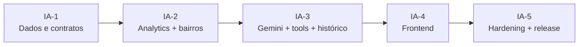

# Sprints — Assistente de IA sobre os Dados (Gemini)

Extensão do **Pizzaria Lucrativa** para responder perguntas em linguagem natural sobre a operação
e gerar gráficos a partir dos dados reais da pizzaria, por exemplo:

- “Quanto eu lucrei no mês de setembro?”
- “Me mostre um gráfico das regiões da cidade que mais tiveram pedidos.”
- “Qual produto deu mais lucro nos últimos 30 dias?”
- “Compare o faturamento deste mês com o anterior.”

Este diretório é o plano de execução da feature. Ele complementa o
[09 — Plano de Implementação](../09-plano-de-implementacao.md) e o
[10 — Sprints de Pedidos, Produção e Lucro](../10-sprints-pedidos-producao-lucro.md),
que cobrem o produto já entregue.

> **Princípio central:** a IA usa uma **camada semântica de métricas** via *function calling*.
> Ela não gera SQL, não acessa o `DbContext` e não recebe `tenantId` do usuário. Toda resposta
> numérica é rastreável a uma tool executada no backend.

---

## 1. Decisões fechadas com o cliente

| Tema | Decisão |
|---|---|
| Provedor | **Google Gemini** (Gemini Developer API), atrás de `IChatModelClient`; modelo configurável |
| Estratégia | **LLM + function calling desde a primeira versão** — sem Fase 0 determinística e sem `IntentParser` |
| Público | **Somente `owner`**; atendente e pizzaiolo não acessam `/ia` nem `/api/v1/ai/*` |
| Histórico | **Persistido por tenant**, configurável (`Ai:History:*`), com retenção, listagem e exclusão |
| Orçamento | Teto **mensal configurável por tenant**; valor em dólares **a confirmar antes do go-live** |
| Região | Catálogo `Neighborhood` + snapshot `Order.RegionSnapshot` |
| Fallback | Sem motor determinístico: em falha/timeout/orçamento, resposta segura + sugestões, nunca números inventados |
| Chave | `Ai__ApiKey` via user-secrets/env; nunca versionada |

> **Ponto pendente:** o valor do teto mensal (`Ai:Budget:MonthlyUsdPerTenant`) ainda não foi
> definido. As sprints deixam a configuração pronta e o valor provisório explícito; o `owner`
> deve confirmar antes da IA-5.

---

## 2. Visão geral das sprints

| Sprint | Nome | Objetivo | Entregável verificável | Pontos | Status |
|---|---|---|---|---|---|
| [IA-1](sprint-ia-01-fundacao-de-dados-e-contratos.md) | Fundação de dados e contratos | Modelar região, histórico e uso persistidos, congelar contratos e criar o agente especialista | `Neighborhood`, `AiConversation`/`AiMessage`/`AiUsageRecord`, DTOs/interfaces compilando; `ai-specialist` registrado | 23 | ✅ Concluída |
| [IA-2](sprint-ia-02-analytics-e-tools.md) | Analytics e catálogo de bairros | Entregar as métricas e o catálogo que as tools vão consumir | `GET /analytics/orders/by-region` correto; CRUD de bairros; pedidos gravando região | 24 | ✅ Concluída |
| [IA-3](sprint-ia-03-chat-gemini-e-historico.md) | Chat Gemini, tools e histórico | Ligar o Gemini com function calling, histórico persistido e orçamento | `POST /ai/chat` responde com tool real; histórico por tenant; owner-only | 28 | ✅ Concluída |
| [IA-4](sprint-ia-04-frontend-do-assistente.md) | Frontend do assistente | Página `/ia`, histórico, gráficos, tabelas e cadastro de bairros | Owner conversa, retoma conversa anterior e vê gráficos | 27 | ⬜ Planejado |
| [IA-5](sprint-ia-05-hardening-governanca-release.md) | Hardening, governança e release | Segurança, observabilidade, rollout e documentação | Release candidate aprovado com UAT e rollback | 20 | ⬜ Planejado |

**Total:** 122 pontos, em 5 sprints de 2 semanas (capacidade de referência: 20–28 pts/sprint).

---

## 3. Equipe de agentes e responsabilidades

| Agente | Papel nesta feature | Arquivos principais |
|---|---|---|
| `orchestrator` | Tech Lead: decompõe, ordena ondas, valida contratos e faz o aceite de cada sprint | `docs/sprints/*`, relatórios de sprint |
| `domain-architect` | Entidades, enums, regras puras, DTOs e interfaces de Application | `Domain/Entities`, `Domain/Enums`, `Application/DTOs`, `Application/Interfaces` |
| `ai-specialist` | **Novo**: cliente Gemini, prompts, tools, histórico/contexto, guardrails, avaliação, custo | `Application/Ai`, `Application/Services/AiChatService.cs`, `Infrastructure/Ai` |
| `backend-specialist` | `AnalyticsService`, mappings, migrations, seed, DI, controllers, rate limit, histórico e orçamento | `Application/Services`, `Infrastructure`, `Api/Controllers`, `Api/Extensions` |
| `frontend-specialist` | Página de chat, histórico, gráficos/tabelas, models, service HTTP, rotas e menu | `frontend/src/app/features/ai`, `core/models`, `app.routes.ts`, shell |
| `qa-test-specialist` | Testes unitários/integração, isolamento de tenant, RBAC, retenção, prompt injection e regressões | `backend/tests/*` |
| `project-organizer` | Sincroniza `docs/`, `.agents/agents` e `.agents/skills`; evita defasagem e duplicidade | `docs/`, `.agents/` |
| `agent-creator` | Meta-agente usado **apenas** para criar/atualizar definições de agentes | `.agents/agents/*.md` |
| `skill-creator` | Meta-agente usado **apenas** para criar/atualizar skills | `.agents/skills/*/SKILL.md` |

> `agent-creator` e `skill-creator` são meta-agentes de governança. Eles não são donos de tarefas
> de produto e não aparecem como responsáveis por código de feature.

### 3.1 Auditoria de duplicidade (por que só um agente novo)

| Necessidade | Coberta por | Novo agente? |
|---|---|---|
| Integração Gemini, prompts, function calling, histórico, guardrails, avaliação e custo | `ai-specialist` | ✅ Sim — não existia especialista de IA |
| Agregações de vendas/lucro, endpoints, persistência e orçamento | `backend-specialist` | ❌ Não — já é o dono de Application/Infrastructure/Api |
| Entidades de região/histórico, DTOs e interfaces | `domain-architect` | ❌ Não — já é o dono de Domain/contratos |
| Tela de chat, histórico, gráficos e UX | `frontend-specialist` | ❌ Não — já é o dono de Angular |
| Testes, RBAC, multi-tenancy, retenção e segurança | `qa-test-specialist` | ❌ Não — segurança de aplicação já está no escopo |
| Documentação, agentes e skills | `project-organizer` | ❌ Não — governança já está no escopo |

**Decisão:** não criar `analytics-specialist`, `security-specialist`, `prompt-engineer` ou
`data-scientist`. Essas responsabilidades já estão cobertas pelos agentes acima; criar agentes
adicionais geraria sobreposição de escopo e conflito de edição.

---

## 4. Decisões de arquitetura (ADRs resumidas)

| ID | Decisão | Justificativa |
|---|---|---|
| ADR-IA-01 | **Function calling sobre camada semântica**, não Text-to-SQL | Evita injection, vazamento entre tenants, SQL incorreto e respostas não auditáveis |
| ADR-IA-02 | `IChatModelClient` na Application; implementação Gemini na Infrastructure | Mantém Clean Architecture e permite trocar modelo/provedor sem alterar a Application |
| ADR-IA-03 | Dados numéricos somente via tools; `ChartSpec` montado no backend | Impede que o modelo invente números ou datasets |
| ADR-IA-04 | Tenant sempre do JWT; tools não aceitam `tenantId` | Reforça o isolamento multi-tenant já garantido pelo query filter |
| ADR-IA-05 | Enviar apenas agregados ao Gemini; sem PII | Privacidade/LGPD e redução de risco |
| ADR-IA-06 | **Sem motor determinístico**; falha segura com mensagem + sugestões | Atende à decisão de ir direto para LLM sem manter um parser de intenções paralelo |
| ADR-IA-07 | Bairro é a granularidade operacional; região é derivada do catálogo `Neighborhood` | O modelo atual só tem `AddressDistrict` (texto livre, apenas delivery) |
| ADR-IA-08 | Relatórios convertem o período local (`America/Sao_Paulo`) para UTC | Evita pedidos da noite do último dia caírem no mês seguinte |
| ADR-IA-09 | **Histórico persistido por tenant**, com retenção e exclusão configuráveis | Requisito do cliente; permite retomar conversa e auditar uso sem guardar PII |
| ADR-IA-10 | Feature **owner-only** | O chat expõe lucro, custos e margens; não deve ser acessível a atendente/pizzaiolo |
| ADR-IA-11 | Gemini via `HttpClient` + adapter de function declarations | Evita acoplar a Application a SDK e permite controlar timeout/retry/custo |
| ADR-IA-12 | `Ai:Enabled` + teto mensal por tenant + kill switch | Rollout seguro e controle de custo |
| ADR-IA-13 | Nunca executar SQL/`EXECUTE` gerado pelo modelo | Elimina a principal superfície de injection e vazamento |

---

## 5. Configuração prevista

```jsonc
{
  "Ai": {
    "Enabled": false,
    "Provider": "Gemini",
    "BaseUrl": "https://generativelanguage.googleapis.com/v1beta",
    "Model": "gemini-2.5-flash",
    "ApiKey": "", // usar Ai__ApiKey via user-secrets/env
    "MaxOutputTokens": 800,
    "TimeoutSeconds": 30,
    "MaxToolRounds": 4,
    "MaxHistoryMessages": 20,
    "CacheMinutes": 5,
    "Budget": {
      "MonthlyUsdPerTenant": 15.0, // valor provisório; confirmar antes do go-live
      "Enforce": true,
      "AlertPercentage": 80
    },
    "History": {
      "Enabled": true,
      "RetentionDays": 90,
      "MaxMessagesPerConversation": 100,
      "StoreToolResults": false
    }
  }
}
```

> `Ai:History:Enabled=false` desliga a persistência sem quebrar o chat. O padrão é `true`,
> conforme a decisão do cliente. `Ai:Budget:MonthlyUsdPerTenant` é obrigatório quando
> `Ai:Budget:Enforce=true`; o valor final será definido pelo `owner`.

---

## 6. Convenções de execução

1. **Um responsável por tarefa.** Cada tarefa tem exatamente um agente accountable; apoio é
   explicitado como “apoio” e não como segundo responsável.
2. **Ondas do `orchestrator`.** Contratos → analytics/persistência → Gemini/tools/histórico →
   frontend → governança. Nunca iniciar uma tarefa cujo contrato ainda não foi congelado.
3. **Handoff explícito.** Ao concluir, o agente envia `send_message` com arquivos, contratos,
   comandos executados e resultado de build/testes.
4. **Critério de pronto por tarefa.** Código compila, aceite da tarefa atendido, sem TODO e com
   documentação da parte pública atualizada.
5. **Rastreabilidade.** O ID da tarefa (`IA1-03`, `IA2-05`, …) aparece no commit/PR e no relatório
   da sprint.
6. **Sem antecipar escopo.** Itens de sprints futuras não entram na sprint atual sem passar pelo
   `orchestrator`.

### 6.1 Definition of Done global

- [ ] `dotnet build backend/PizzariaLucrativa.slnx` com 0 erros.
- [ ] `dotnet test backend/PizzariaLucrativa.slnx` com 100% dos testes passando.
- [ ] `npm run build` no `frontend/` com 0 erros (quando houver mudança de UI).
- [ ] Toda resposta numérica da IA rastreável a uma tool e coberta por teste.
- [ ] Isolamento de tenant comprovado por teste (tenant A não vê tenant B), inclusive no histórico.
- [ ] RBAC comprovado: `owner` acessa; `atendente`/`pizzaiolo` recebem `403`.
- [ ] Histórico persistido, retomável, deletável e com retenção configurável.
- [ ] Nenhum dado pessoal de cliente enviado ao Gemini nem salvo no histórico.
- [ ] Chaves somente via user-secrets/env; nenhum segredo versionado.
- [ ] Custo por pergunta e teto mensal documentados e observáveis.
- [ ] `Ai:Enabled=false` desliga a feature sem chamada externa e sem quebrar a aplicação.
- [ ] `docs/05`, `docs/07`, `docs/08` e este diretório atualizados na mesma sprint.
- [ ] `project-organizer` validou que agentes/skills não ficaram defasados.

---

## 7. Dependências entre sprints



- **IA-1** concluída em 2026-10-26 (contratos congelados, migration aplicada e build verde).
- **IA-2** depende dos contratos congelados da IA-1.
- **IA-3** depende da IA-2 (métricas e catálogo prontos) e dos contratos de histórico/orçamento.
- **IA-4** depende do contrato de `/ai/chat` e do histórico da IA-3. Pode iniciar os models e a
  navegação quando o contrato HTTP estiver congelado, mas o aceite só ocorre com a IA-3 integrada.
- **IA-5** depende de IA-3 e IA-4 concluídas.

---

## 8. Fora de escopo da feature

- Text-to-SQL livre ou agente com acesso direto ao banco.
- Motor determinístico/`IntentParser` como caminho alternativo de linguagem natural.
- Treinamento/fine-tuning de modelo próprio.
- Voz, upload de arquivos, OCR ou análise de imagens.
- Respostas para clientes finais no WhatsApp (backlog; pode reutilizar as tools depois).
- Streaming token a token (backlog; MVP responde em uma chamada).
- Suporte simultâneo a vários provedores (a abstração fica pronta, mas o MVP entrega Gemini).
- Vertex AI com service account (MVP usa Gemini Developer API com API key; avaliar depois).

---

## 9. Como acompanhar

Cada arquivo de sprint contém: objetivo, tarefas com agente responsável, ordem de execução,
critérios de aceite, riscos, métricas e checklist de encerramento. O `orchestrator` deve atualizar
o status da sprint e o checklist ao final de cada onda.

**Próximo passo após aprovação:** iniciar a IA-2 pela camada de analytics (`backend-specialist`),
criando `AnalyticsService`, o CRUD de bairros e a resolução de região na criação do pedido.
