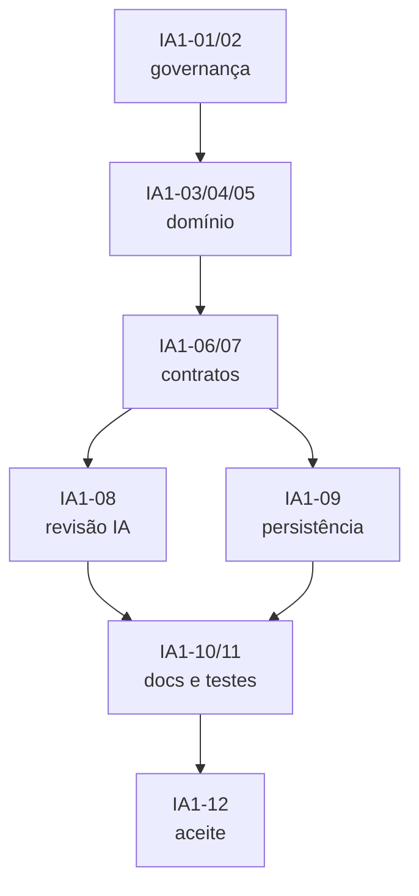

# Sprint IA-1 — Fundação de dados e contratos

> **Feature:** Assistente de IA sobre os dados (Gemini)
> **Duração:** 2 semanas · **Capacidade:** 23 pontos
> **Status:** ✅ Concluída
> **Depende de:** —
> **Habilita:** IA-2 (analytics/bairros), IA-3 (Gemini/tools/histórico), IA-4 (frontend)

## Relatório de aceite (IA1-12)

**Data:** 2026-10-26 · **Responsável:** `orchestrator` · **Resultado:** ✅ Aprovada

| Item | Evidência |
|---|---|
| Domínio | `Neighborhood`, `NeighborhoodRegion`, `NeighborhoodId`/`RegionSnapshot` em `Order`, `AiConversation`, `AiMessage`, `AiUsageRecord`, `AiMessageRole` |
| Contratos | `IAnalyticsService`, `IAiChatService`, `IChatModelClient`, `IAiConversationStore`, `INeighborhoodService`, `IAiUsageService`, `IDateTimeProvider` e `IReportPeriodResolver`; DTOs em `AnalyticsDtos.cs` e `AiDtos.cs` |
| ChartSpec | `kind`/`valueFormat` serializados em minúsculas; labels e séries só são montados no backend a partir de tool |
| Persistência | 4 mappings + `OrderMap`/DbSets; migration `20261026161958_AddNeighborhoodsAndAiHistory` aplicada em SQLite limpo; seed idempotente de 12 bairros |
| Documentação | `docs/05-modelo-de-dados.md` e `docs/07-api.md` §§19–22; matrizes de teste revisadas na IA-2/IA-3 |
| Build | `dotnet build backend/PizzariaLucrativa.slnx` — **0 erros, 0 avisos** |
| Pendências | IA-2 implementa serviços, endpoints, resolução de região e seed de 3 meses; IA-3 implementa Gemini, histórico e orçamento; valor do teto mensal ainda a confirmar antes do go-live |

## Objetivo

Preparar a fundação para a IA sem escrever a integração com o Gemini ainda:
modelar bairro/região, modelar o **histórico persistido por tenant**, congelar os contratos de
analytics/chat/tools e registrar o agente especialista.

## Entregável verificável

- Entidade `Neighborhood` e enums de região no domínio, com `Order` vinculado e snapshot de região.
- Entidades `AiConversation`, `AiMessage` e `AiUsageRecord` para histórico e uso persistidos por tenant.
- DTOs e interfaces de `IAnalyticsService`, `IAiChatService`, `IChatModelClient`,
  `IAiConversationStore`, `INeighborhoodService` e `IDateTimeProvider`.
- Migration `AddNeighborhoodsAndAiHistory` aplicável em SQLite.
- `ai-specialist` registrado em `.agents/agents/ai-specialist.md`.
- Contrato de `ChartSpec`, histórico e uso/orçamento documentado em `docs/07-api.md`.

## Agentes envolvidos

| Agente | Responsabilidade na sprint |
|---|---|
| `orchestrator` | Congelar contratos, ordenar ondas e aceitar a sprint |
| `domain-architect` | Entidades, enums, DTOs e interfaces |
| `backend-specialist` | Mapeamento EF, migration, índices e seed do catálogo |
| `qa-test-specialist` | Revisão dos contratos e matriz de testes |
| `project-organizer` | Registro do agente, documentação e auditoria de duplicidade |
| `ai-specialist` | Revisão dos contratos de tools, histórico, orçamento e do `ChartSpec` |

---

## Tarefas

### Onda 1 — Governança e agente (concluída no planejamento)

- [x] **IA1-01** — Criar o agente `ai-specialist` seguindo o formato do `agent-creator`, com escopo
  focado em Gemini/tools/prompts/histórico/guardrails e fronteiras explícitas para não sobrepor
  os demais agentes.
  **Agente:** `project-organizer` (executando as regras do `agent-creator`).
  **Entregável:** `.agents/agents/ai-specialist.md`.
  **Aceite:** frontmatter YAML válido; `name`, `description`, `tools`, `subagent`, `mainAgent`,
  `model` e `commandExecutionPolicy` presentes; nenhuma ferramenta inventada; seção “Fora de escopo”.

- [x] **IA1-02** — Auditar a equipe existente e registrar a decisão de não criar agentes duplicados
  (`analytics-specialist`, `security-specialist`, `prompt-engineer`, `data-scientist`).
  **Agente:** `project-organizer`.
  **Entregável:** seção “Auditoria de duplicidade” em `docs/sprints/README.md`.
  **Aceite:** cada necessidade da feature mapeada para um agente existente ou para o `ai-specialist`;
  nenhum agente com dois donos para a mesma responsabilidade.

### Onda 2 — Domínio e contratos (sequencial)

- [x] **IA1-03** — Criar o catálogo de bairros/regiões:
  `Neighborhood` (herda `TenantEntity`): `Name`, `Region`, `IsActive`;
  enum `NeighborhoodRegion` (`Center`, `North`, `South`, `East`, `West`, `Other`);
  invariantes: nome obrigatório; unicidade de `Name` por tenant garantida no serviço
  (o TPT impede índice único composto com `TenantId`).
  **Agente:** `domain-architect`.
  **Entregável:** `Domain/Entities/Neighborhood.cs`, `Domain/Enums/NeighborhoodRegion.cs`.
  **Aceite:** entidade pura, sem dependência de EF/ASP.NET; construtor/validações coerentes com as
  demais entidades; testes de invariantes previstos para a IA-2.

- [x] **IA1-04** — Estender `Order` com a granularidade de entrega:
  `NeighborhoodId?` e `RegionSnapshot?` (enum).
  Manter `AddressDistrict` para compatibilidade e histórico.
  **Agente:** `domain-architect`.
  **Entregável:** alteração em `Domain/Entities/Order.cs` e DTOs de entrada/saída de pedido.
  **Aceite:** pedidos antigos continuam válidos (`RegionSnapshot` nulo → “Não classificado” nos relatórios);
  nenhum pedido de outro tenant pode ser vinculado a um bairro.

- [x] **IA1-05** — Criar o modelo de histórico e uso persistido:
  `AiConversation` (herda `TenantEntity`): `UserId`, `Title`, `CreatedAt`, `UpdatedAt`, `IsArchived`;
  `AiMessage` (herda `TenantEntity`): `ConversationId`, `Role`, `Content`, `InputTokens`,
  `OutputTokens`, `EstimatedCostUsd`, `ToolsUsed`, `CreatedAt`;
  `AiUsageRecord` (herda `TenantEntity`): `UserId`, `ConversationId?`, `Provider`, `Model`,
  `InputTokens`, `OutputTokens`, `EstimatedCostUsd`, `LatencyMs`, `IsFallback`, `CreatedAt`;
  enum `AiMessageRole` (`User`, `Assistant`).
  **Agente:** `domain-architect`.
  **Entregável:** `Domain/Entities/AiConversation.cs`, `AiMessage.cs`, `AiUsageRecord.cs`,
  `Domain/Enums/AiMessageRole.cs`.
  **Aceite:** histórico não armazena PII de cliente; `Content` limitado a 8.000 caracteres;
  `ToolsUsed` limitado a 500 caracteres; `AiUsageRecord` não guarda conteúdo de mensagem/prompt;
  nenhum payload bruto de tool por padrão.

- [x] **IA1-06** — Definir os DTOs de analytics, chat e histórico:
  `AnalyticsPeriodDto`, `OrdersByRegionItemDto`, `OrdersByRegionDto`, `OrdersSummaryDto`,
  `SalesHeatmapItemDto`, `ChatRequestDto` (com `conversationId?`), `ChatMessageDto`,
  `ChatAnswerDto`, `AnswerBlockDto` (`text`, `chart`, `table`, `kpis`), `ChartSpecDto`,
  `ChartSeriesDto`, `TableBlockDto`, `AiMetaDto`, `ConversationSummaryDto`,
  `ConversationDetailDto`, `ConversationMessageDto`, `NeighborhoodDto`,
  `NeighborhoodInputDto`, `AiUsageDto`.
  **Agente:** `domain-architect`.
  **Entregável:** `Application/DTOs/AiDtos.cs` e/ou `AnalyticsDtos.cs`.
  **Aceite:** contratos imutáveis (`sealed record`), sem tipos de EF/HTTP; `ChartSpecDto` com
  `kind` (`bar|line|pie|doughnut`), `title`, `labels`, `series`, `valueFormat`
  (`currency|number|percent`); `ChatAnswerDto` inclui `conversationId`, `messageId` e `usage`.

- [x] **IA1-07** — Definir as interfaces:
  `IAnalyticsService` (por região, resumo de pedidos, heatmap, comparação de períodos),
  `IAiChatService` (`AskAsync`), `IChatModelClient` (`CompleteAsync` com tools),
  `IAiConversationStore` (persistência, listagem, exclusão e retenção),
  `INeighborhoodService` (CRUD de bairros/regiões), `IAiUsageService` (tokens/custo/orçamento),
  `IDateTimeProvider`/`IReportPeriodResolver`.
  **Agente:** `domain-architect`.
  **Entregável:** `Application/Interfaces/*.cs`.
  **Aceite:** interfaces coesas (ISP), sem `tenantId` em parâmetros, cancelamento
  (`CancellationToken`) em todas as operações assíncronas; `IAiConversationStore` permite
  listar/deletar por `conversationId` sem expor outro tenant.

- [x] **IA1-08** — Revisar os contratos para **Gemini + function calling + histórico + orçamento**:
  formato das tool declarations, mensagens persistidas, janela de contexto, retenção,
  `Ai:Enabled`, `Ai:History:*` e `Ai:Budget:*`; garantir que o modelo não monte datasets.
  **Agente:** `ai-specialist` (apoio: `domain-architect`).
  **Entregável:** seção “Contrato de tools, histórico e configuração” em `docs/07-api.md`.
  **Aceite:** cada tool tem entrada/saída tipada, limites e nenhum parâmetro livre/SQL;
  o contrato de histórico não expõe PII nem payload bruto de tool; o orçamento é verificável
  antes da chamada ao Gemini.

### Onda 3 — Persistência e documentação (após contratos)

- [x] **IA1-09** — Implementar a persistência:
  `NeighborhoodMap`, `AiConversationMap`, `AiMessageMap`, `AiUsageRecordMap` em
  `Infrastructure/Persistence/Mappings/`, atualização de `OrderMap`, índices em
  `Neighborhood.Name`, `Order.RegionSnapshot`, `AiConversation.UserId`,
  `AiMessage.ConversationId`, `AiMessage.CreatedAt`, `AiUsageRecord.CreatedAt` e
  `AiUsageRecord.UserId` (o TPT já indexa `TenantId` na tabela base), migration
  `AddNeighborhoodsAndAiHistory` e seed inicial de bairros por região.
  **Agente:** `backend-specialist`.
  **Entregável:** mappings, `AppDbContext` (DbSets), migration e seed.
  **Aceite:** `dotnet build` sem erros; migration aplica em SQLite; seed idempotente;
  nenhum índice único global; histórico e uso isolados pelo query filter de tenant.

- [x] **IA1-10** — Atualizar `docs/05-modelo-de-dados.md` (Neighborhood, AiConversation, AiMessage)
  e `docs/07-api.md` (contratos de analytics/chat/histórico, `ChartSpec` e configuração).
  **Agente:** `project-organizer` (apoio: `domain-architect`).
  **Entregável:** docs atualizados e links para os arquivos de sprint.
  **Aceite:** documentação bate com os DTOs reais; exemplos em JSON válidos; sem caminho obsoleto.

- [x] **IA1-11** — Definir a matriz de testes da feature e revisar os contratos antes do congelamento:
  lucro, região, período/fuso, isolamento de tenant (incluindo histórico), RBAC owner-only,
  retenção/exclusão, prompt injection, orçamento e falha do Gemini.
  **Agente:** `qa-test-specialist`.
  **Entregável:** “Matriz de testes” na IA-2/IA-3 e checklist de revisão.
  **Aceite:** todo DTO/interfaces tem cenário feliz e de borda; toda tool tem teste de argumento inválido;
  todo endpoint de histórico tem teste de tenant e owner.

### Onda 4 — Aceite

- [x] **IA1-12** — Congelar contratos, validar build e publicar handoff para IA-2.
  **Agente:** `orchestrator`.
  **Entregável:** relatório curto no topo deste arquivo (data, contratos, build, pendências).
  **Aceite:** `dotnet build backend/PizzariaLucrativa.slnx` verde; nenhuma interface alterada depois
  sem comunicação explícita aos agentes de IA-2/IA-3/IA-4.

---

## Checklist de revisão dos contratos (IA1-11)

- [x] Todo DTO de IA-1 é `sealed record`, sem tipo de EF Core/ASP.NET e sem `tenantId`.
- [x] `ChartSpec` usa `kind`/`valueFormat` em minúsculas e só é montado a partir de tool.
- [x] Toda operação assíncrona das novas interfaces aceita `CancellationToken`.
- [x] `IAiConversationStore` lista/obtém/exclui por `conversationId` sob o query filter do tenant.
- [x] `Content` (8.000) e `ToolsUsed` (500) têm limite no mapeamento; `AiUsageRecord` não guarda conteúdo.
- [x] Matriz da IA-2 cobre região, período/fuso, RBAC, isolamento de tenant e bairro inválido.
- [x] Matriz da IA-3 cobre tool inválida, histórico cross-tenant, retenção, orçamento e falha do Gemini.
- [x] Migration `AddNeighborhoodsAndAiHistory` aplicada em banco SQLite limpo.
- [x] `dotnet build backend/PizzariaLucrativa.slnx` com 0 erros.

## Ordem de execução (DAG)

## Critérios de aceite da sprint

1. `Neighborhood`, `Order.RegionSnapshot`, `AiConversation` e `AiMessage` existem, compilam e têm
   migration aplicável.
2. `IAnalyticsService`, `IAiChatService`, `IChatModelClient`, `IAiConversationStore` e
   `IAiUsageService` estão definidos sem dependência de provedor ou de EF Core na Application.
3. O contrato de `ChartSpec`, histórico e orçamento está documentado; nenhum gráfico depende de
   números digitados pelo modelo.
4. O agente `ai-specialist` existe, é válido e não duplica o escopo de nenhum outro agente.
5. `dotnet build backend/PizzariaLucrativa.slnx` termina com 0 erros.

## Riscos e mitigação

| Risco | Mitigação |
|---|---|
| `AddressDistrict` é texto livre e só existe em delivery | Catálogo `Neighborhood` + normalização na criação do pedido + fallback “Não classificado” |
| Região histórica mudar quando o bairro for remapeado | `Order.RegionSnapshot` congela a região no momento do pedido |
| TPT impedir índice único `(TenantId, Name)` | Unicidade garantida no `NeighborhoodService`, como já ocorre com `Order.Code` |
| Histórico armazenar PII ou payload sensível | Salvar só mensagens e metadados; `StoreToolResults=false` por padrão |
| Histórico crescer sem limite | `RetentionDays` e `MaxMessagesPerConversation` configuráveis |
| Contratos mudarem depois de IA-2/IA-3 iniciarem | Congelamento formal na IA1-12 e comunicação via `orchestrator` |
| Criar agente redundante | Auditoria IA1-02 e seção de duplicidade no README |

## Checklist de encerramento

- [x] IA1-01 a IA1-12 concluídas.
- [x] Build verde e migration aplicada em banco limpo.
- [x] Docs `05` e `07` atualizados.
- [x] `project-organizer` confirmou que agentes/skills não ficaram defasados.
- [x] `orchestrator` publicou o handoff para IA-2.
