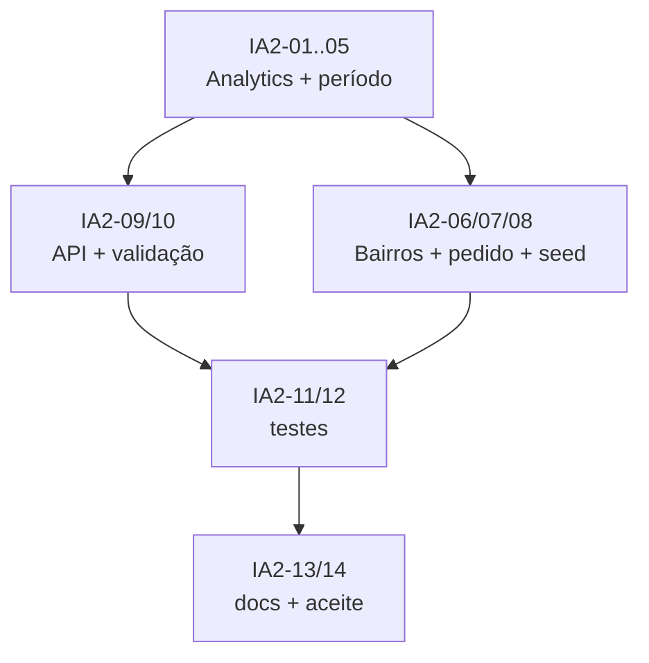

# Sprint IA-2 — Analytics e catálogo de bairros

> **Feature:** Assistente de IA sobre os dados (Gemini)
> **Duração:** 2 semanas · **Capacidade:** 24 pontos
> **Status:** ✅ Concluída
> **Depende de:** IA-1 (contratos e modelo de dados)
> **Habilita:** IA-3 (Gemini/tools/histórico), IA-4 (frontend)

## Relatório de aceite (IA2-14)

**Data:** 2026-10-26 · **Responsável:** `orchestrator` · **Resultado:** ✅ Aprovada

| Item | Evidência |
|---|---|
| Analytics | `IAnalyticsService` + `AnalyticsService` com `GetOrdersByRegionAsync`, `GetOrdersSummaryAsync`, `GetSalesHeatmapAsync`, `ComparePeriodsAsync` |
| Bairros | `INeighborhoodService` + `NeighborhoodService`, `NeighborhoodsController` CRUD com RBAC OwnerOnly e isolamento por tenant |
| Período/fuso | `IReportPeriodResolver` + `ReportPeriodResolver`, `IDateTimeProvider` com `America/Sao_Paulo` |
| Integração pedidos | `OrderService` resolve bairro por `NeighborhoodId` ou `AddressDistrict` e grava `NeighborhoodId`/`RegionSnapshot` |
| API | `AnalyticsController` com validação de período/limite e proteção OwnerOnly |
| DI/Registro | Serviços registrados em `Application.DependencyInjection` |
| Build/Testes | `dotnet build` e `dotnet test` verdes (90 Domain + 39 Api) |

## Objetivo

Entregar a camada de dados que as tools do Gemini vão consumir: métricas de lucro/pedidos,
catálogo de bairros/regiões, resolução de região na criação do pedido e seed de demonstração.
Esta sprint **não** implementa chat nem chama LLM.

## Entregável verificável

- `GET /api/v1/analytics/orders/by-region` devolve pedidos, faturamento e participação por bairro/região.
- `GET /api/v1/analytics/orders/summary`, `/sales/heatmap` e `/compare` funcionando.
- CRUD `/api/v1/neighborhoods` permite ao owner manter o catálogo.
- Pedidos de delivery com bairro cadastrado gravam `NeighborhoodId` e `RegionSnapshot`.
- Fuso `America/Sao_Paulo` aplicado corretamente na conversão de “mês X” para UTC.
- Seed demo com bairros/regiões variados e histórico de 3 meses.
- Testes de integração e unitários verdes.

## Agentes envolvidos

| Agente | Responsabilidade na sprint |
|---|---|
| `orchestrator` | Ordenar as ondas e aceitar a sprint |
| `domain-architect` | Ajustes finais de contratos e regra pura de período, se necessário |
| `backend-specialist` | `AnalyticsService`, período/fuso, endpoints, CRUD, seed e resolução no pedido |
| `ai-specialist` | Revisão dos formatos de saída para consumo pelas tools do Gemini |
| `qa-test-specialist` | Testes de analytics, RBAC, tenant, fuso, CRUD e resolução de região |
| `project-organizer` | Atualização de `docs/05` e `docs/07` |

---

## Tarefas

### Onda 1 — Serviço de analytics (backend)

- [x] **IA2-01** — Implementar `AnalyticsService.GetOrdersByRegionAsync(period, limit)`:
  agrupar por `RegionSnapshot` (fallback `AddressDistrict` → “Não classificado”),
  retornar `District`, `Region`, `OrdersCount` (todos os pedidos não cancelados),
  `CompletedOrdersCount`, `Revenue` (somente `Completed`), `AverageTicket` e `SharePercentage`.
  **Agente:** `backend-specialist`.
  **Entregável:** `Application/Services/AnalyticsService.cs`.
  **Aceite:** números batem com consulta manual no seed; nenhum pedido cancelado entra em receita;
  `limit` entre 1 e 50; resultado ordenado por `OrdersCount` desc.

- [x] **IA2-02** — Implementar `GetOrdersSummaryAsync(period)`:
  contagem por status, tipo (`Counter/Pickup/Delivery`) e forma de pagamento; total de pedidos,
  ticket médio e faturamento concluído.
  **Agente:** `backend-specialist`.
  **Entregável:** mesmo service, DTO `OrdersSummaryDto`.
  **Aceite:** somas dos grupos iguais ao total; pedidos anônimos do site contabilizados como canal público.

- [x] **IA2-03** — Implementar `GetSalesHeatmapAsync(period)`:
  pedidos concluídos por dia da semana × faixa horária (0–23h ou blocos de 2h), no fuso local.
  **Agente:** `backend-specialist`.
  **Entregável:** série `SalesHeatmapItemDto`.
  **Aceite:** 7 × N células sempre presentes (inclusive zeros); horário local, não UTC.

- [x] **IA2-04** — Implementar `ComparePeriodsAsync(periodA, periodB)`:
  faturamento, lucro bruto, pedidos e ticket médio, com variação absoluta e percentual.
  **Agente:** `backend-specialist`.
  **Entregável:** DTO de comparação e reutilização de `IReportService`.
  **Aceite:** divisão por zero tratada (variação nula quando base = 0); períodos validados (máx. 366 dias).

- [x] **IA2-05** — Implementar `ReportPeriodResolver`:
  conversão de mês/ano e intervalos (“hoje”, “7 dias”, “30 dias”, “mês passado”, “mês X”)
  de `America/Sao_Paulo` para UTC; início inclusivo e fim exclusivo.
  **Agente:** `backend-specialist`.
  **Entregável:** `Application/Services/ReportPeriodResolver.cs` + `IDateTimeProvider` implementado.
  **Aceite:** pedido às 22h de 30/09 BRT entra em setembro; teste de virada de mês e de ano.

### Onda 2 — Catálogo de bairros e resolução no pedido

- [x] **IA2-06** — Criar `NeighborhoodsController` (`/api/v1/neighborhoods`) com CRUD
  (`GET`, `POST`, `PUT`, `DELETE`) restrito a `owner`:
  validação de `Name` obrigatório, `Region` válido, unicidade `TenantId + Name` no serviço
  (TPT) e bloqueio de exclusão de bairro em uso por pedido (ou desativação via `IsActive`).
  **Agente:** `backend-specialist`.
  **Entregável:** `Api/Controllers/NeighborhoodsController.cs`, `INeighborhoodService` e validadores.
  **Aceite:** owner cadastra/edita/desativa bairros; duplicidade retorna `409`;
  outro tenant não enxerga nem edita o bairro; exclusão em uso é bloqueada ou desativa.

- [x] **IA2-07** — Atualizar `OrderService.CreateAsync` (e o fluxo público) para resolver
  `AddressDistrict` no catálogo `Neighborhood` do tenant (trim + case-insensitive) e gravar
  `NeighborhoodId` e `RegionSnapshot`; quando não houver correspondência, manter nulos e
  classificar como “Não classificado” nos relatórios.
  **Agente:** `backend-specialist`.
  **Entregável:** alteração em `Application/Services/OrderService.cs` + testes de criação.
  **Aceite:** pedido de delivery com “Centro” grava região `Center`; bairro desconhecido não quebra
  o pedido; pedido de outro tenant não resolve bairro alheio; pedidos antigos continuam válidos.

- [x] **IA2-08** — Atualizar o seed demo:
  catálogo de bairros por região (Centro, Jardins, Moema, Tatuapé, Santana, Pinheiros etc.),
  pedidos de delivery distribuídos entre bairros e histórico de pelo menos 3 meses.
  **Agente:** `backend-specialist`.
  **Entregável:** `Infrastructure/Persistence/DemoSeeder.cs`.
  **Aceite:** gráfico por região tem pelo menos 5 barras distintas; “mês passado” tem dados;
  seed idempotente; bairros existem antes dos pedidos.

### Onda 3 — API, segurança e validação

- [x] **IA2-09** — Criar `AnalyticsController` (`/api/v1/analytics`) com os endpoints de leitura,
  `[Authorize(Policy = "OwnerOnly")]` e versionamento pelo `ApiControllerBase`.
  **Agente:** `backend-specialist`.
  **Entregável:** `Api/Controllers/AnalyticsController.cs`.
  **Aceite:** thin controller; nenhuma regra de negócio; `from/to` validados; `403` para não-owner.

- [x] **IA2-10** — Aplicar validação de período e payload:
  `from <= to`, intervalo máximo de 366 dias, período padrão de 30 dias,
  `limit` de região entre 1 e 50 e mensagens de erro no envelope padrão.
  **Agente:** `backend-specialist`.
  **Entregável:** validadores FluentValidation + tratamento de erro.
  **Aceite:** payload inválido retorna `400` sem stack trace; período vazio usa o padrão documentado.

### Onda 4 — Testes, docs e aceite

- [x] **IA2-11** — Testes unitários de `ReportPeriodResolver`, cálculo de participação e
  resolução de região (mês por nome, mês passado, 30 dias, virada de ano, fuso, bairro inexistente).
  **Agente:** `qa-test-specialist`.
  **Entregável:** testes no projeto de domínio/application.
  **Aceite:** 100% dos cenários da matriz da IA-1 cobertos; testes determinísticos.

- [x] **IA2-12** — Testes de integração:
  `GET /analytics/orders/by-region`, `/orders/summary`, `/sales/heatmap`, `/compare`;
  CRUD de bairros (duplicidade e cross-tenant); resolução de região na criação do pedido;
  RBAC (`atendente` → 403); isolamento de tenant; mês com pedido às 22h BRT.
  **Agente:** `qa-test-specialist`.
  **Entregável:** `backend/tests/PizzariaLucrativa.Api.Tests/AnalyticsTests.cs` e
  `NeighborhoodTests.cs`.
  **Aceite:** `dotnet test` verde; nenhum teste depende de rede/provedor externo.

- [x] **IA2-13** — Atualizar `docs/05-modelo-de-dados.md` (bairro/região) e
  `docs/07-api.md` (endpoints de analytics e CRUD de bairros) com exemplos reais.
  **Agente:** `project-organizer`.
  **Entregável:** docs sincronizados com os contratos.
  **Aceite:** exemplos executáveis contra o seed; sem referência a endpoint inexistente.

- [x] **IA2-14** — Aceite da sprint e handoff para IA-3.
  **Agente:** `orchestrator`.
  **Entregável:** relatório de aceite com build, testes, endpoints e formatos de saída.
  **Aceite:** métricas e catálogo prontos para serem consumidos pelas tools; contrato de saída congelado.

---

## Ordem de execução (DAG)

## Matriz de testes mínima

| Cenário | Tipo | Resultado esperado |
|---|---|---|
| “Pedidos por região” no seed | Integração | `200`, barras por bairro/região, sem “Não classificado” quando cadastrado |
| Pedido 22h BRT no último dia do mês | Unitário | Pertence ao mês local |
| `from` > `to` | Integração | `400` |
| Período > 366 dias | Integração | `400` |
| Atendente chama `/analytics/*` | Integração | `403` |
| Tenant A consulta; tenant B tem pedidos | Integração | Números apenas de A |
| Bairro duplicado no tenant | Integração | `409` |
| Bairro do tenant A editado pelo tenant B | Integração | `404`/`403`, sem alteração |
| Delivery com bairro cadastrado | Integração | `NeighborhoodId` e `RegionSnapshot` preenchidos |
| Delivery com bairro desconhecido | Integração | Pedido criado com região nula / “Não classificado” |
| Delivery com `neighborhoodId` de outro tenant | Integração | `400`; pedido não vincula bairro alheio |
| Delivery com bairro inativo | Integração | `400`; pedido não é criado |
| Bairro com nome vazio | Integração | `400` no envelope padrão |
| Seed sem pedidos no período | Integração | Lista vazia, sem erro |

## Critérios de aceite da sprint

1. Métricas de lucro/pedidos/região corretas e com fuso local.
2. Catálogo de bairros/regiões editável pelo owner e isolado por tenant.
3. Pedidos de delivery gravam região no momento da criação.
4. Endpoints protegidos por `OwnerOnly` e validação de entrada.
5. Isolamento de tenant e RBAC comprovados por teste.
6. `dotnet build` e `dotnet test` verdes.
7. `docs/05` e `docs/07` atualizados.

## Riscos e mitigação

| Risco | Mitigação |
|---|---|
| Bairro não preenchido em pedidos de balcão/retirada | Relatório agrupa “Não classificado”; nunca inventa região |
| Região mudar no catálogo | `Order.RegionSnapshot` congela o valor histórico |
| TPT impedir índice único `(TenantId, Name)` | Unicidade garantida no `NeighborhoodService` |
| Fuso horário gerar divergência de mês | `ReportPeriodResolver` centralizado + testes de virada |
| Seed sem variedade | IA2-08 com catálogo e histórico de 3 meses |
| Formato de saída não servir às tools | IA2-14 congela os DTOs antes da IA-3 |

## Checklist de encerramento

- [x] IA2-01 a IA2-14 concluídas.
- [x] Gráfico por região com pelo menos 5 bairros no seed.
- [x] CRUD de bairros/regiões validado e protegido por tenant.
- [x] Build e suíte de testes verdes.
- [x] Handoff publicado para IA-3.
