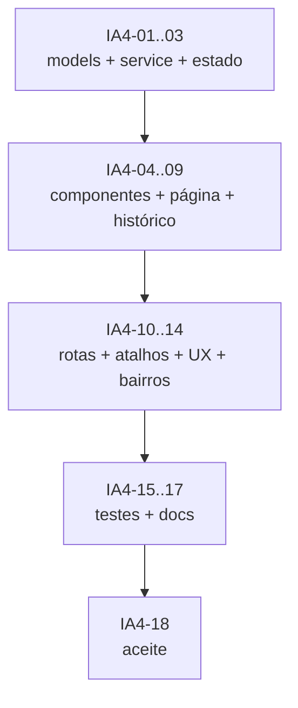

# Sprint IA-4 — Frontend do assistente

> **Feature:** Assistente de IA sobre os dados (Gemini)
> **Duração:** 2 semanas · **Capacidade:** 27 pontos
> **Status:** ✅ Concluída
> **Depende de:** IA-3 (chat, histórico e contrato HTTP estáveis)
> **Habilita:** IA-5 (hardening e release)

## Objetivo

Construir a experiência do assistente no Angular 18: página de chat, **histórico persistido**,
sugestões, renderização segura de texto, blocos de KPI, tabelas e gráficos com Chart.js.
O frontend **não calcula** métricas nem inventa dados: apenas renderiza o `ChatAnswerDto`
devolvido pela API e retoma conversas salvas pelo backend.

## Entregável verificável

- Rota `/ia` acessível ao `owner`, com item no menu e atalho na página `/lucro`.
- Chat funcional com sugestões, loading, erro, vazio e retry.
- Histórico persistido: listar conversas, retomar, iniciar nova e excluir.
- `ChartBlockComponent` renderiza `bar`, `line`, `pie` e `doughnut` com BRL/número/percentual.
- Tabelas e KPIs renderizados a partir dos blocos da API.
- Tela “Bairros e regiões” para o owner manter o catálogo usado nos gráficos.
- Layout responsivo (375 px) e acessível (teclado, `aria-live`, contraste).

## Agentes envolvidos

| Agente | Responsabilidade na sprint |
|---|---|
| `orchestrator` | Coordenar ondas e aceitar a sprint |
| `frontend-specialist` | Models, service HTTP, página, histórico, componentes, rotas e estilos |
| `backend-specialist` | Ajustes no contrato/API se o frontend encontrar lacuna |
| `qa-test-specialist` | Plano de testes de UI, histórico, acessibilidade e aceite visual |
| `project-organizer` | Atualização de `docs/08-frontend-angular.md` e governança |

---

## Tarefas

### Onda 1 — Modelos e comunicação

- [x] **IA4-01** — Criar `core/models/ai.models.ts` espelhando exatamente os DTOs da API:
  `ChatRequest` (com `conversationId?`), `ChatMessage`, `ChatAnswer`, `AnswerBlock`
  (`text|chart|table|kpis`), `ChartSpec`, `ChartSeries`, `TableBlock`, `KpiBlock`, `AiMeta`,
  `ConversationSummary`, `ConversationDetail`, `ConversationMessage`, `AiUsage`.
  **Agente:** `frontend-specialist`.
  **Entregável:** `frontend/src/app/core/models/ai.models.ts`.
  **Aceite:** sem `any`; nomes camelCase iguais ao JSON; `kind`/`valueFormat` como unions tipadas.

- [x] **IA4-02** — Criar `features/ai/ai.service.ts`:
  `chat(message, conversationId?)`, `suggestions()`, `health()`,
  `listConversations()`, `getConversation(id)`, `deleteConversation(id)` e `usage()`,
  com `HttpClient` + `inject()`, `environment.apiBaseUrl` e tratamento de erro.
  **Agente:** `frontend-specialist`.
  **Entregável:** `frontend/src/app/features/ai/ai.service.ts`.
  **Aceite:** nenhuma URL montada no componente; tipagem estrita; erro HTTP propagado de forma tratável.

- [x] **IA4-03** — Criar o estado da conversa com Signals:
  `messages`, `conversations`, `currentConversationId`, `loading`, `loadingHistory`, `error`,
  `suggestions`; métodos `send`, `loadConversation`, `newConversation`, `deleteConversation`,
  `retry` e `clear`.
  **Agente:** `frontend-specialist`.
  **Entregável:** estado em `ai.page.ts` (ou `ai-chat.store.ts` se a página ficar grande).
  **Aceite:** `OnPush`; envio otimista; bloqueio de envio vazio; retomar conversa mantém
  `conversationId`; nova pergunta não perde o histórico persistido.

### Onda 2 — Componentes de resposta

- [x] **IA4-04** — Criar `ChartBlockComponent`:
  recebe `ChartSpec`, registra Chart.js e renderiza com `ng2-charts`; suporta `bar`, `line`,
  `pie` e `doughnut`; formata eixo/tooltip conforme `valueFormat` (`currency`, `number`, `percent`);
  trata lista vazia com estado “sem dados”.
  **Agente:** `frontend-specialist`.
  **Entregável:** `features/ai/chart-block.component.ts|html|scss`.
  **Aceite:** gráfico reproduz exatamente labels/séries da API; responsivo; sem recriar o gráfico
  a cada ciclo de change detection; legenda e cores legíveis.

- [x] **IA4-05** — Criar `TableBlockComponent` e `KpiBlockComponent`:
  tabela Material com colunas/linhas da API e cards de KPI com `BrlPipe`/`PctPipe`.
  **Agente:** `frontend-specialist`.
  **Entregável:** componentes em `features/ai/`.
  **Aceite:** valores formatados em PT-BR; tabela com scroll horizontal no mobile; sem `innerHTML`
  para conteúdo da API.

- [x] **IA4-06** — Criar `ChatMessageComponent`:
  bolha do usuário/assistente, timestamp, indicador “digitando”, botão copiar e estado de erro
  com retry; renderização de texto seguro (parágrafos/negrito/lista) sem `innerHTML` cru.
  **Agente:** `frontend-specialist`.
  **Entregável:** `features/ai/chat-message.component.ts|html|scss`.
  **Aceite:** texto malicioso da API/usuário não executa HTML; links externos com `rel="noopener"`;
  acessível por leitor de tela.

- [x] **IA4-07** — Criar o painel de histórico `ai-history.component`:
  lista de conversas (título/data), destaque da atual, botão “Nova conversa”, ação de excluir
  com confirmação, estado vazio e carregamento.
  **Agente:** `frontend-specialist`.
  **Entregável:** `features/ai/ai-history.component.ts|html|scss`.
  **Aceite:** consome `GET/DELETE /ai/conversations`; não mostra conversa de outro tenant;
  exclusão remove da lista sem quebrar o chat; acessível por teclado.

- [x] **IA4-08** — Criar a página `ai.page`:
  cabeçalho “Assistente IA”, sidebar de histórico, chips de sugestão, lista de mensagens,
  composer com `textarea` (Enter envia, Shift+Enter quebra linha), botão nova conversa
  e aviso de que a IA pode errar.
  **Agente:** `frontend-specialist`.
  **Entregável:** `features/ai/ai.page.ts|html|scss`.
  **Aceite:** estados loading/erro/vazio/limite; scroll automático para a última mensagem;
  composer desabilitado durante request; histórico visível em desktop e colapsável no mobile.

- [x] **IA4-09** — Exibir metadados de transparência:
  período consultado, tools usadas, uso/custo estimado e botão “Ver dados” que abre a tabela
  quando existir; nunca exibir o prompt interno.
  **Agente:** `frontend-specialist`.
  **Entregável:** seção de detalhes no `ChatMessageComponent`.
  **Aceite:** metadados da API apenas; sem chamada extra; sem exposição de configuração/chave.

### Onda 3 — Integração, rotas e UX

- [x] **IA4-10** — Adicionar rota `/ia` em `app.routes.ts` com `roleGuard('owner')` e `tenantGuard`;
  item “Assistente IA” no menu do shell (ícone `auto_awesome`), visível só para owner.
  **Agente:** `frontend-specialist`.
  **Entregável:** `app.routes.ts` + `shell.component.ts`.
  **Aceite:** atendente/pizzaiolo não veem o item e recebem redirecionamento/403 coerente;
  rota carregada com lazy loading.

- [x] **IA4-11** — Adicionar atalho “Perguntar à IA” na página `/lucro`, levando para `/ia`
  com uma pergunta pré-preenchida (ex.: “Explique o lucro deste período”).
  **Agente:** `frontend-specialist`.
  **Entregável:** botão + query param ou estado de navegação.
  **Aceite:** abre o chat com a pergunta pronta, sem disparar duas requisições.

- [x] **IA4-12** — Implementar feedback do usuário:
  botões “Resposta útil / Não foi útil” e campo opcional de comentário, enviando para endpoint
  de telemetria (ou log no backend) sem PII.
  **Agente:** `frontend-specialist` (apoio: `backend-specialist` para endpoint).
  **Entregável:** UI de feedback + `POST /ai/feedback` (se aprovado na sprint).
  **Aceite:** feedback não bloqueia o chat; se endpoint não existir, botão fica oculto.

- [x] **IA4-13** — Responsividade e acessibilidade:
  testar 375 px, 768 px e desktop; navegação por teclado; `aria-live` para novas respostas;
  contraste AA; foco visível; `prefers-reduced-motion`.
  **Agente:** `frontend-specialist`.
  **Entregável:** ajustes de SCSS/template + checklist preenchido.
  **Aceite:** sem overflow horizontal; chat e histórico utilizáveis só com teclado;
  leitor de tela anuncia resposta.

### Onda 4 — Cadastro de bairros, testes, documentação e aceite

- [x] **IA4-14** — Criar a tela “Bairros e regiões” em `features/neighborhoods`
  (tabela + dialog), acessível em Cadastros para owner:
  listar, criar, editar, ativar/desativar e excluir bairro; campos `Name`, `Region`.
  **Agente:** `frontend-specialist`.
  **Entregável:** `features/neighborhoods/*` + `neighborhoods.service.ts` + rota/menu.
  **Aceite:** CRUD consome `/api/v1/neighborhoods`; duplicidade exibe erro amigável;
  `Region` em PT-BR; estados de loading/erro/vazio; sem `any`.

- [x] **IA4-15** — Criar testes de unidade do frontend (Karma/Jasmine):
  `AiService` (URL, payload, erro, histórico), `ChartSpec` → configuração do Chart.js e
  formatação de valores; `NeighborhoodsService` (CRUD e erro).
  **Agente:** `frontend-specialist` (apoio: `qa-test-specialist`).
  **Entregável:** `*.spec.ts` dos services/componentes críticos.
  **Aceite:** `npm test -- --watch=false` verde (ou comando equivalente do projeto).

- [x] **IA4-16** — Executar aceite visual/funcional com o seed demo:
  lucro do mês, gráfico por região, produto, canal, erro de rede, resposta sem dados,
  retomar conversa após reload, excluir conversa e CRUD de bairros.
  **Agente:** `qa-test-specialist` (apoio: `frontend-specialist`).
  **Entregável:** checklist de aceite com screenshots.
  **Aceite:** todos os cenários aprovados em desktop e mobile; histórico persiste após reload;
  nenhum gráfico vazio indevido.

- [x] **IA4-17** — Atualizar `docs/08-frontend-angular.md` com a feature, rotas, histórico,
  componentes e padrões de renderização segura de resposta; atualizar `docs/07-api.md` com o
  contrato de histórico e o CRUD de bairros.
  **Agente:** `project-organizer`.
  **Entregável:** docs atualizados.
  **Aceite:** caminhos de arquivo corretos; exemplos de `ChartSpec` e de conversa; sem referência
  a componente inexistente.

- [x] **IA4-18** — Aceite da sprint e handoff para IA-5.
  **Agente:** `orchestrator`.
  **Entregável:** relatório com build Angular, testes, checklist de UX e pendências.
  **Aceite:** `npm run build` verde; rota `/ia` funcional contra o backend local; sem regressão
  nas páginas existentes.

---

## Ordem de execução (DAG)

## Matriz de testes mínima

| Cenário | Tipo | Resultado esperado |
|---|---|---|
| Enviar “Quanto lucrei em setembro?” | Manual/E2E | Mensagem do usuário + resposta com KPI e gráfico |
| Resposta com `chart.kind=bar` | Unitário | `ChartConfiguration` com labels/séries da API |
| Resposta com bloco `table` | Manual | Tabela renderizada com valores formatados |
| Resposta sem dados | Manual | Estado “sem dados”, sem gráfico quebrado |
| Erro 500/429 | Manual | Mensagem amigável + retry, sem perder histórico |
| Texto com `<script>` | Unitário | Não executa; renderizado como texto |
| Retomar conversa após reload | Manual/E2E | Histórico carregado na ordem e com `conversationId` |
| Excluir conversa | Manual/E2E | Some da lista; chat inicia nova conversa |
| Atendente acessa `/ia` | Manual/RBAC | Redirecionado/403 sem renderizar dados |
| Viewport 375 px | Manual | Sem overflow; composer, gráfico e histórico utilizáveis |
| Navegação por teclado | Manual | Foco visível; Enter envia; Shift+Enter quebra linha |
| Leitor de tela | Manual | Nova resposta anunciada via `aria-live` |
| Cadastro de bairro duplicado | Manual | Mensagem de erro, sem perder o formulário |
| Bairro desativado | Manual | Não aparece em novos pedidos, mas permanece no histórico |

## Critérios de aceite da sprint

1. Rota `/ia` protegida e acessível apenas ao owner.
2. Chat renderiza texto, KPI, tabela e gráfico sem calcular métricas no cliente.
3. Histórico persistido: listar, retomar, nova conversa e excluir.
4. Gráficos idênticos aos dados da API, com formatação BRL/percentual.
5. Estados de loading, erro, vazio, limite e retry implementados.
6. Responsivo e acessível; nenhum HTML não sanitizado.
7. CRUD de bairros/regiões funcional e protegido por tenant.
8. `npm run build` verde e sem regressão visual nas telas existentes.
9. `docs/07` e `docs/08` atualizados.

## Riscos e mitigação

| Risco | Mitigação |
|---|---|
| Gráfico recriado a cada detecção de mudança | `OnPush` + `computed` + `update()` do Chart.js |
| HTML injetado na resposta | Renderização segura por blocos; nunca `innerHTML` cru |
| Contrato da API mudar durante a sprint | Contrato congelado na IA-3; ajustes via `orchestrator` |
| Histórico grande travar a tela | Paginação/limite na API e carregamento sob demanda |
| Chat lento parecer travado | Indicador “digitando”, timeout e mensagem de fallback |
| Mobile quebrar com tabela larga | Scroll horizontal e layout empilhado |
| Duplicar lógica de formatação | Reutilizar `BrlPipe`/`PctPipe` e `ChartSpec.valueFormat` |

## Checklist de encerramento

- [x] IA4-01 a IA4-18 concluídas.
- [x] Build Angular verde.
- [x] Aceite visual em desktop e mobile.
- [x] Histórico persistido, retomável e deletável na UI.
- [x] CRUD de bairros/regiões integrado ao backend.
- [x] Nenhum `innerHTML` com conteúdo da API.
- [x] `docs/07` e `docs/08` atualizados.
- [x] Handoff publicado para IA-5.
